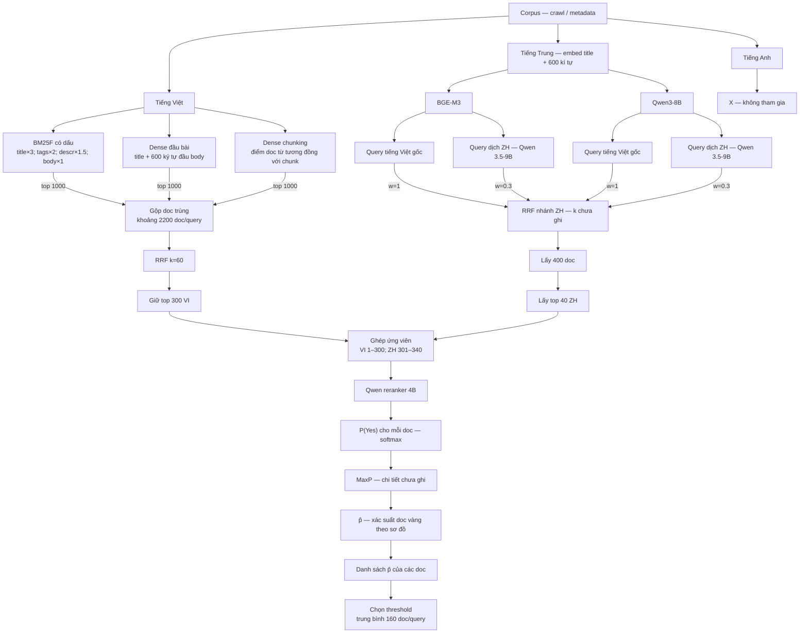

# Pipeline 0,391 — Bản đọc từ sơ đồ Miro

Cập nhật **20/10/2026**. Nguồn: **hai ảnh chụp Miro do người dùng cung cấp trong hội thoại**, gồm phần truy hồi và phần rerank/chọn doc. Đây là bản mô tả bằng chữ cho agent tiếp quản; các tham số bên dưới đọc từ ảnh, chưa phải kết quả đối chiếu code hoặc tái chạy pipeline.

Baseline làm việc là **0,391**, theo người dùng. Chưa có bộ metric thành phần, tên run, config hoặc artifact scoring để suy ra Doc F2/Chunk F2/FINAL riêng. Bản HTML nguồn: [Pipeline 0,391 - Miro.html](<../Pipeline 0,391 - Miro.html>); sơ đồ canvas trong HTML không thay thế bản chép này.

## 1. Tóm tắt để agent bắt đầu

```text
Corpus + crawl/metadata
  ├─ Tiếng Việt: 3 nguồn, mỗi nguồn top 1000
  │    → gộp doc trùng, khoảng 2200 ứng viên/query
  │    → RRF k=60 → top 300 VI
  ├─ Tiếng Trung: BGE-M3 + Qwen3-8B, mỗi model chạy query VI gốc và query ZH dịch
  │    → RRF với weights 1 / 1 / 0.3 / 0.3 → 400 doc → top 40 ZH
  └─ Tiếng Anh: đánh dấu X, không tham gia nhánh ghép đang mô tả

300 VI + 40 ZH → 340 ứng viên trước rerank
  → Qwen reranker 4B → P(Yes) bằng softmax
  → MaxP → p̂, được sơ đồ gọi là “xác suất doc vàng”
  → danh sách p̂ cho các doc → chọn threshold để trung bình 160 doc/query
```

**Ba con số khác nhau:** 400 là bước trung gian của nhánh ZH; 340 là số ứng viên ghép theo sơ đồ; khoảng 160 là **trung bình số doc sau threshold**, không phải top-k cố định cho mỗi query. Chưa có thống kê runtime xác nhận mọi query đều đủ các số lượng này.

## 2. Sơ đồ luồng



Nhãn phía trên các nhánh VI trong ảnh ghi **“Embed - Qwen 3.5-9B”**. Giữ nguyên cách ghi này; ảnh chưa giải thích chính xác nhãn đó áp dụng cho bước nào hoặc checkpoint cụ thể. Không tự thay nó bằng model embedding khác. Sơ đồ Mermaid diễn đạt luồng, không bổ sung định nghĩa model còn thiếu.

## 3. Nhánh tiếng Việt

| Nguồn | Nội dung/điểm theo ảnh | Số doc lấy |
|---|---|---:|
| BM25F có dấu | `title ×3`, `tags ×2`, `descr ×1.5`, `body ×1` | Top 1000 |
| Dense đầu bài | `title + 600 ký tự đầu của body` | Top 1000 |
| Dense chunking | Điểm doc là điểm tương đồng với chunk | Top 1000 |

Gộp các doc trùng của ba danh sách, sơ đồ ghi khoảng **2.200 doc/query**. Dùng **RRF k=60**, lấy **top 300 VI** để chuyển sang rerank. Ảnh chưa ghi trọng số RRF giữa ba nguồn, cách xử lý ties hoặc rank bắt đầu từ 0/1.

Nhãn **“Lấy full”** nằm sau nút top 300: trong bản này được hiểu là đưa cả danh sách 300 ứng viên VI sang bước ghép. **Không dùng nhãn này làm bằng chứng chunk hoặc input reranker bằng toàn bộ body.**

Dense chunking chưa ghi cách chia chunk hoặc cách gom điểm nhiều chunk thành một điểm doc; không tự mặc định max/mean. Nhãn MaxP xuất hiện ở phần sau là một bước khác trong sơ đồ.

## 4. Nhánh tiếng Trung

Corpus ZH được ghi **“Embed title + 600 kí tự”**, đi qua hai model **BGE-M3** và **Qwen3-8B**. Ảnh không ghi đầy đủ checkpoint hay phần văn bản 600 ký tự của nhánh này; không tự điền từ cấu hình VI.

Mỗi model có hai cách truy vấn: query VI gốc và query dịch sang ZH bằng **Qwen 3.5-9B**. Bốn danh sách đóng góp vào RRF:

| Model retrieval | Query | Trọng số RRF theo ảnh |
|---|---|---:|
| BGE-M3 | Tiếng Việt gốc | 1 |
| Qwen3-8B | Tiếng Việt gốc | 1 |
| BGE-M3 | Dịch sang tiếng Trung | 0.3 |
| Qwen3-8B | Dịch sang tiếng Trung | 0.3 |

Sau RRF: **lấy 400 doc**, rồi **lấy top 40 ZH** để ghép với nhánh VI. Ảnh chưa ghi `k` của RRF nhánh ZH, độ sâu từng nguồn trước fusion hoặc các bước lọc bổ sung. **k=60 được ghi ở nhánh VI; không tự áp sang ZH.**

Hai nhãn Qwen cần giữ riêng: **Qwen3-8B** ở retrieval ZH; **Qwen 3.5-9B** ở dịch query và dòng nhãn phía VI. Không coi chúng là cùng một model.

## 5. Ghép, rerank và chọn doc cuối

1. Ghép **top 300 VI** với **top 40 ZH**. Nút trong ảnh ghi `Top 300 Viet; 301–340 Trung`: đây là vị trí trong danh sách ứng viên **trước rerank**, chưa phải thứ tự output cuối.
2. Chạy **Qwen reranker 4B**. Sơ đồ ghi `P(Yes) cho mỗi doc (Hàm softmax)`; chưa nêu checkpoint, prompt, input fields hay giới hạn độ dài.
3. Đi qua bước **MaxP**, sau đó có `p̂: Xác suất doc vàng`. Ảnh chưa cho công thức MaxP hoặc phép biến đổi từ `P(Yes)` thành `p̂`; không đồng nhất hai giá trị hoặc tự khẳng định đã có calibration logistic.
4. Tạo danh sách chứa `p̂` của các doc.
5. Chọn **threshold trên p̂** sao cho lấy **trung bình 160 doc/query**. Đây là mục tiêu trung bình của policy được vẽ; số doc mỗi query có thể khác nhau. Ảnh chưa ghi giá trị threshold, dấu `>`/`≥`, cách xử lý ties hoặc threshold dùng chung hay thay đổi theo query.

Không có cơ sở từ ảnh để áp `k=160` cố định, giữ đúng40 ZH sau threshold hoặc cố định300 VI ở output. **300/40 là quota ứng viên đầu vào**, không phải quota được bảo đảm sau bước rerank/lọc.

## 6. Những gì sơ đồ chưa mô tả

| Cần biết khi tái tạo run | Tình trạng |
|---|---|
| Run/submission ID; corpus/query snapshot; paths/hashes | Chưa có trong ảnh |
| Checkpoint cụ thể và vai trò nhãn “Embed - Qwen 3.5-9B” | Chưa rõ |
| Weights/ties/rank convention của RRF VI; k và cutoffs nguồn ZH | Chưa ghi đủ |
| Chunking và aggregation điểm dense chunk | Chưa ghi |
| Input reranker, prompt, truncation | Chưa ghi |
| MaxP; hàm tính p̂; tham số calibration nếu có | Chưa ghi |
| Threshold cụ thể, phạm vi theo query, ties, số doc thực mỗi query | Chưa ghi |
| Membership/dedup ở bước ghép và xử lý thiếu ứng viên | Chưa ghi |
| Chunk text được nộp, offsets, số chunk/doc và exporter | **Không được mô tả trong hai ảnh** |
| Bộ metric thành phần và scoring artifact của 0,391 | Chưa cung cấp |

Agent dùng bản này để hiểu kiến trúc và đặt đúng câu hỏi khi đọc config/code. Không thêm các phần chưa biết bằng cách sao chép recipe w045 hoặc bài 0,4076. Không thay số nguồn báo bằng số đo giả.

## 7. Liên kết bàn giao

- [Đặc tả JSON](specs/pipeline_0391.json): bản tham chiếu có cấu trúc cho agent, không phải config CLI; trường chưa xác nhận giữ null.
- [Ghi nhận baseline 0,391](reports/BASELINE_0391_20261020.md): nguồn và mức xác nhận.
- [TXT_handover.md](TXT_handover.md): trạng thái tiếp quản.
- [PLAN.md](PLAN.md): kế hoạch thử nghiệm tiếp theo, không phải cấu hình tái tạo pipeline.
- [improvement_log.md](improvement_log.md): lịch sử cải tiến và bổ sung bằng chứng.

Baseline ở trên giữ nguyên theo ảnh. Hướng BEAR hiện hành nằm ở **[BEAR_ALGORITHM.md](BEAR_ALGORITHM.md)** và [PLAN v3.3](PLAN.md): dùng ứng viên/score baseline để chọn lại doc và chọn chunk bằng evidence có cấu trúc. Audit/threshold tuning là hỗ trợ; chúng không thay hai output retrieval. Đây là đề xuất mới, không phải bước được đọc từ ảnh.
