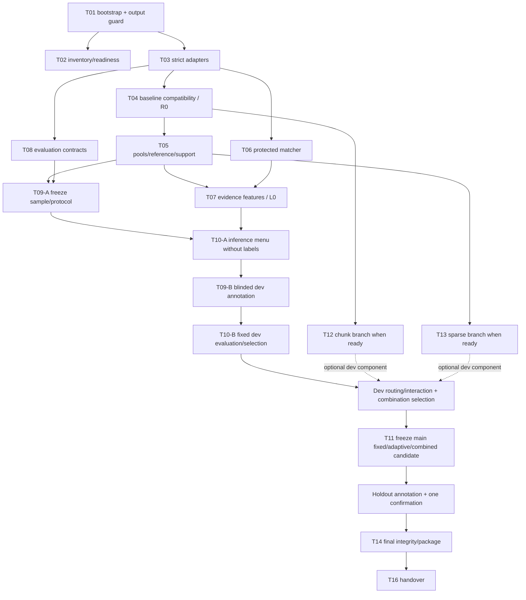

# PLAN — Triển khai Biomedical Evidence-Aware Retrieval (BEAR)

> Ngày lập: **19/10/2026**. Nguồn ý tưởng: [TXT_Proposal.md](TXT_Proposal.md). Đây là kế hoạch triển khai, chưa phải code BEAR hoặc báo cáo BEAR vượt baseline.
>
> **Yêu cầu ưu tiên của người dùng: mọi file mới phải nằm trong `TXT/`.** Áp dụng cả code, test, config, dữ liệu nhận thêm, manifest, báo cáo, cache, file tạm và submission. File kế hoạch này là `TXT/PLAN.md`, không tạo `PLAN.md` ở root.
>
> Mục tiêu của tài liệu: agent nhận một task có thể xác định ngay đầu vào, file cần tạo, thuật toán, kiểm thử, đầu ra và điều kiện chuyển bước. Không cần tự chọn lại thiết kế nghiên cứu trong lúc code.

## 1. Cách dùng kế hoạch và giới hạn công việc

1. Đọc mục 1–5 trước khi code. Chọn **task chưa xong đầu tiên có đủ dependency** trong mục 11.
2. Làm từng task; ghi trạng thái và bằng chứng vào `TXT/reports/IMPLEMENTATION_STATUS.md` khi bắt đầu triển khai. Không đánh dấu hoàn thành chỉ vì đã tạo file.
3. Mỗi task phải kết thúc bằng: code/artifact liên quan, kiểm tra phù hợp, kết quả thực tế, blocker còn lại và task kế tiếp.
4. Khi thiếu dữ liệu, đi theo nhánh `missing` của task. Tiếp tục làm phần interface/fixture độc lập; không tự dựng corpus, nhãn hoặc benchmark giả.
5. Tài liệu này chốt các mặc định kỹ thuật **đề xuất** để agent bắt đầu. Chỉ đổi chúng trong một config/protocol mới, có lý do, trước khi mở holdout.
6. Vòng đầu chỉ làm readiness, adapter, baseline compatibility, matcher/evidence, L0 và fixed control nếu đủ nhãn. Sparse, adaptive, allocation và discovery có dependency riêng; không chạy toàn bộ ma trận tự động.

### 1.1. Thứ tự ưu tiên khi các tài liệu mâu thuẫn

| Vấn đề | Nguồn cần dùng |
|---|---|
| Phạm vi thay đổi, vị trí file mới | Yêu cầu người dùng trong phiên này: tất cả dưới `TXT/`. Layout ở proposal/plan cũ phải được remap. |
| Ý tưởng và phương pháp nghiên cứu | `TXT/TXT_Proposal.md`, sau đó các quyết định triển khai được ghi rõ trong PLAN này. |
| Baseline 15/10 | `HANDOVER.md` + `scripts/build_best.sh` + code được gọi; điểm trong handover là **REPORTED** cho tới khi tái lập. |
| Hành vi code hiện có | Hàm và lệnh thực tế trong checkout; docstring cũ không được thay thế code hoặc đính chính mới hơn. |
| Kết quả lịch sử | Mục có ngày và đính chính tương ứng trong `doc/PROGRESS.md`; `doc/METHODS.md` chủ yếu mô tả trạng thái 07/10. |
| Evaluator của archive có sẵn | Cấu hình và kết quả đọc được từ chính archive đó, chỉ áp dụng cho lượt chấm đó. |
| Luật hiện hành và evaluator đầy đủ | Cần đặc tả/tokenizer/scorer có nguồn gốc. Không suy ra toàn bộ luật từ một tham số trong archive. |

Nhãn bằng chứng trong báo cáo: `CODE_VERIFIED`, `ARTIFACT_OBSERVED`, `REPORTED`, `PROPOSED`, `UNRESOLVED`. Hai nhãn đầu chỉ xác nhận điều đã quan sát, không tự xác nhận chất lượng phương pháp mới.

### 1.2. Những việc không nằm trong yêu cầu lập kế hoạch hiện tại

Phiên soạn PLAN chỉ đọc repo và tạo tài liệu này. Các lệnh, module, test và artifact BEAR được mô tả bên dưới **chưa tồn tại**, trừ những file hiện có được chỉ rõ. Không hiểu checklist là các việc đã chạy thành công. Không tải model, giải nén gói lớn, chạy GPU, refit calibration hoặc nộp leaderboard trong bước lập kế hoạch.

## 2. Snapshot checkout đã kiểm tra

### 2.1. File đã đọc và vai trò

| Nhóm | File hiện có | Điều cần lấy |
|---|---|---|
| Đề xuất | `TXT/TXT_Proposal.md`; `TXT/BIOMEDICAL_ADAPTIVE_RETRIEVAL_AGENT_PLAN.md` | H1–H6, P200/PLARGE/PNEW, residual fusion, evidence, controls, evaluation. Proposal mới điều chỉnh một số điểm của plan cũ. |
| Bàn giao | `HANDOVER.md`; `README.md` | Baseline, gói dữ liệu cần nhận, kiến trúc và các đường dẫn lịch sử. |
| Bối cảnh | `doc/CLAUDE.md`; `doc/METHODS.md`; `doc/PIPELINE.md`; `doc/SETUP.md`; các mục liên quan của `doc/PROGRESS.md` | Cách chấm được ghi nhận, lịch sử corpus, failed experiments, hạ tầng và quy ước. |
| Query | `query_processing/expand.py`, `translate.py`, `pipeline.py`, `llm.py`, `README.md`; `examples/sample_queries.jsonl` | Entity/translation schema và parse status. |
| Retrieval | `index/slug_bm25.py`, `bm25.py`, `bm25_ent.py`, `dense.py`, `dense_chunks.py`, `fuse.py`, `merge_scores.py`, `hybrid_cands.py` | Rank/score contracts, tokenizer và candidate flow. |
| Rerank | `rerank/qwen_rerank.py`; `rerank/chunk_rerank.py` | Score Qwen, chunk score và namespace chỉ số chunk. |
| Baseline cuối | `scripts/build_best.sh`; `scripts/val_calib.py`; `val_calib.py`; `crawl/filter_new_corpus.py`; `submit/submission.py` | Rebuild recipe, p(gold), filter, chunk policy, export/fingerprint. |
| Corpus/checks | Schema trong `crawl/crawler.py`; `index/chunk.py`; `utils/audit.py`; `utils/clean.py`; `tests/test_offline.py` | Body bất biến, offset, audit và phạm vi test hiện có. |
| Vận hành | `env/requirements-local.txt`; `env/requirements-train.txt`; các script BM25/dense/chunk liên quan | Dependency và tên artifact; nhiều shell script còn đường dẫn trước khi restructure. |
| Archive | `scoring_result.zip`; danh sách thành viên của `prediction_result.zip`, `x12m_ext10.zip` | Bằng chứng runtime bổ sung, cần tách khỏi handover. Không giải nén khi soạn PLAN. |

Không tìm thấy `AGENTS.md` trong cây được kiểm tra. Khi agent bắt đầu triển khai phải kiểm tra lại, vì checkout có thể đã thay đổi.

### 2.2. Trạng thái dữ liệu và thay đổi có sẵn

- `data/` hiện chỉ có `.gitkeep`: chưa có corpus, enriched queries, rank sources hoặc beta để tái lập handover.
- Git status ban đầu có các file root bị xóa: `CLAUDE.md`, `METHODS.md`, `PIPELINE.md`, `PROGRESS.md`, `SETUP.md`; có `TXT/`, `doc/`, `val_calib.py` chưa được track. Tôn trọng trạng thái này; không restore/move/xóa chúng.
- Tài liệu hướng dẫn hiện nằm trong `doc/`, dù nhiều link/lệnh lịch sử trỏ root.
- Chưa có package BEAR, full qrels, gold passage text, tokenizer evaluator hoặc scorer chính thức đầy đủ trong các file đã kiểm tra.
- Không chạy lại crawler/clean/chunker để bù dữ liệu thiếu. Phải nhận đúng snapshot hoặc xác định experiment chưa đủ điều kiện.

### 2.3. Baseline cần khóa

| Thuộc tính | Snapshot bàn giao 15/10/2026 — REPORTED |
|---|---|
| Run | `w045_TF` |
| Doc F2 / Chunk F2 / FINAL | `0.3605 / 0.3279 / 0.3442` |
| Legacy doc fingerprint | `c1e068422e5f` |
| Legacy chunk fingerprint | `fd07f9fc029a` |
| Ranking docs | `w045_zh38w_e120`, 200 doc/query |
| Số query trong submission | 1.200, ID 1–1200 theo exporter hiện có |
| Corpus | `corpus_new.sqlite` đúng snapshot đã clean/chunk, không tự thay bằng dataset mới nhất |
| Calibration | **`scripts/val_calib.py` + đúng `beta.json` 8 hệ số** |
| Allocation | Top-40 tối đa 2 chunk/doc; 41–120 tối đa 1; điều chỉnh bằng p đã làm tròn 4 chữ số |
| Ngưỡng plan | Top-120: `p < 0.04` bỏ chunk; 121–200: `p >= 0.05` thêm 1 chunk |
| Nén | LZMA của exporter hiện có, dictionary 768 MiB; cần dự trù RAM |

`val_calib.py` ở root có mở rộng/MaxP và các run 16–17/10. Không thay bản trong `scripts/` chỉ vì tên giống hoặc mới hơn. `p(gold)` kế thừa phục vụ allocation; không phải item-level gold cho BEAR.

### 2.4. Archive bổ sung: không bỏ qua nhưng chưa đổi baseline

Đã đọc `scoring_result.zip` bằng `zipfile` ở chế độ đọc:

| Thành viên/thuộc tính | Quan sát được |
|---|---|
| Thành viên | `metadata`, `evaluation.json`, `scores.txt`, `details.jsonl` |
| `evaluation.json` | 600 query, document/chunk đều 593 query được chấm |
| Configuration | `overlap_threshold=0.4`, `duplicate_threshold=0.8`, `overlap="token LCS length / gold token count"`, `macro_empty_gold="excluded"`, `audit=false` |
| Tokenizer path ghi trong runtime | `/app/program/tokenizer.json`; file tokenizer đó chưa có trong checkout |
| Doc F2 / Chunk F2 | `0.407343155932693 / 0.3378781929969602` |
| FINAL trong `scores.txt` | `0.3726` |
| `details.jsonl` | 600 qid duy nhất, nằm trong 1–1200; có tổng số prediction/hit/gold theo query và feedback từng chunk |
| Kiểm tra macro đã thực hiện | Trung bình F2 trên **593 dòng có gold > 0** khớp `evaluation.json` đến sai số float; không lấy trung bình cả 600 dòng |

`details.document` chỉ có `precision, recall, f2, predicted, relevant_predictions, gold`. `details.chunk.predictions` có `doc_id, chunk_order, token_count, relevant, best_overlap, best_gold_chunk_id`. Ví dụ doc ID runtime có namespace `corpus:...`, khác ID số/string số của exporter.

`prediction_result.zip` chứa `metadata` và `x12m_ext10.json`; `x12m_ext10.zip` chứa một `x12m_ext10.json`. Hai entry JSON đều có **717.335.942 byte chưa nén**, nhưng **chưa kiểm tra content hash bằng nhau và chưa xác minh chúng thuộc scoring archive này**. Không gọi chúng là artifact baseline w045.

Task inventory phải:

1. Ghi hash archive và SHA-256 nội dung entry theo luồng khi cần; không `json.load` cả 717 MB chỉ để xem schema.
2. Bỏ qua entry `metadata` khi chọn JSON prediction. Hàm legacy lấy entry đầu tiên không phù hợp archive có metadata.
3. Chứng minh liên kết prediction–score bằng thông tin submission/provenance nếu có; so counts/schema chỉ là kiểm tra nhất quán, chưa đủ chứng minh nguồn gốc.
4. Đặt trạng thái `runtime_observed_unlinked` cho tới khi có bằng chứng liên kết. Giữ reported baseline handover riêng.
5. Giữ phản hồi này trong miền `observed_feedback`; không join vào inference features. `chunk.relevant=false` không có nghĩa doc irrelevant; `best_gold_chunk_id` không cung cấp gold text để chấm chunk mới.
6. Không suy public/private IDs hoặc labels chưa được cung cấp. Không thiết kế các lượt nộp để suy ngược hidden labels.

### 2.5. Những sửa hiểu biết bắt buộc từ tài liệu lịch sử

- Plan cũ ghi **micro F2** ở dòng 36; `doc/CLAUDE.md:49` và runtime archive bổ sung cho thấy macro trong phạm vi tương ứng. Dùng macro theo contract, không dùng câu micro của plan cũ.
- Cùng tập 200 doc thì đổi thứ tự không tăng Doc F2. Xem đính chính `doc/PROGRESS.md:2314`, `2463`.
- Không bỏ ZH theo các nhận xét đầu `METHODS`: corpus/coverage và kết quả đã thay đổi, xem `PROGRESS:2620–2631`, `2681–2687`.
- Gate cũ có silver oracle chỉ hơn khoảng 1,56%; đây là bằng chứng lịch sử để hạ kỳ vọng, không phải upper bound của BEAR mới.
- IDF chọn chunk và chunk 400/450 từng thua. Giữ chunk boundaries khoảng 900 token khi thử evidence/fusion.
- `SETUP.md` nói GPU 50 GB là thông tin lịch sử; kiểm tra tài nguyên thực, không cộng hai GPU 24 GB thành một vùng VRAM 48 GB.
- Không lấy first-N query làm representative: `PROGRESS:2061–2062` ghi 300 query đầu dài/khó hơn.

## 3. Đích triển khai và kiến trúc chỉ bên trong TXT

### 3.1. Câu hỏi phải trả lời theo thứ tự

1. Có dựng lại đúng baseline và đo đúng metric không?
2. Exact/critical/local evidence có nghĩa đúng, đủ coverage và cung cấp thông tin ngoài baseline rank không?
3. Fixed evidence hoặc fixed BM25/dense residual có ích không?
4. E(q) có dự báo được lợi thế lexical-centric so với semantic-centric trên dữ liệu ngoài tuning không?
5. Adaptive có thắng **best fixed cùng components/pool/budget** không?
6. Chunk selector, sparse hoặc alias/discovery có giá trị độc lập nào, với chi phí bao nhiêu?

Kết quả hợp lệ có thể là giữ fixed, chỉ cải thiện chunk, hoặc kết luận chưa đủ bằng chứng. Không đặt điều kiện hoàn thành là adaptive bắt buộc phải thắng.

### 3.2. Layout đích

Tạo dần theo task, không tạo toàn bộ skeleton rỗng trước:

```text
TXT/
  PLAN.md                                      # tài liệu này
  TXT_Proposal.md                               # đã có
  BIOMEDICAL_ADAPTIVE_RETRIEVAL_AGENT_PLAN.md     # đã có, tài liệu cũ
  __init__.py                                  # tạo ở T01
  bear/
    __init__.py
    cli.py                                     # argparse, CPU mặc định
    contracts.py                               # dataclasses, validation, status/error codes
    io.py                                      # paths, JSONL, canonical hash, atomic outputs
    adapters.py                                # query/rank/score/SQLite adapters
    baseline.py                                # recipe handover, compatibility adapters
    pools.py                                   # P200/PLARGE/reference/support set
    matching.py                                # protected spans, exact/alias matching
    evidence.py                                # concept coverage, local, E(q)
    features.py                                # joins và cache/feature shards
    fusion.py                                  # pure fixed/adaptive inference
    evaluation.py                              # local doc/replacement/passage diagnostics
    paired.py                                  # paired comparison, group bootstrap
    experiments.py                             # run manifests, config menus, freeze
    integrity.py                               # full submission/provenance checks
    chunk_experiments.py                       # chỉ tạo khi làm C1/C2/C3
    sparse.py                                  # chỉ tạo khi làm S1/S2
  tests/
    __init__.py
    fixtures.py                                # sinh dữ liệu giả trong TXT/runtime/tmp
    test_io_contracts.py
    test_adapters.py
    test_baseline_compat.py
    test_matching_evidence.py
    test_pools_fusion.py
    test_evaluation.py
    test_runner_integrity.py
  configs/                                     # JSON, không cần thêm YAML dependency
    readiness.json
    l0_pilot.json
    protocol_v1.json
    menus_v1.json
    frozen/                                    # chỉ sau lựa chọn trên dev
  manifests/                                   # inputs, sources, pools, split, features
  reports/                                     # readiness, contracts, parity, experiments
  inputs/                                      # nhận artifact mới tại đây; read-only sau freeze
    handover/data/                             # giữ tên đường dẫn tương đối của gói bàn giao
    evaluation/                                # qrels/tokenizer/spec nếu được cung cấp
  runtime/
    tmp/
    cache/
    features/
    runs/<run_id>/
  requirements-bear.txt                         # chỉ thêm khi dependency thực sự cần
```

Chọn package `TXT.bear` để chạy từ repo root bằng `python -B -m TXT.bear.cli ...`; không cần `pip install -e`, root `pyproject.toml`, `src/` hay sửa `PYTHONPATH`. Import code cũ bằng `from index.fuse import rrf` và `from submit import submission` khi cần.

Không sửa code cũ trong vòng đầu. Những chỗ hardcode path được xử lý bằng adapter compatibility trong `TXT/bear/baseline.py`, có differential tests. Nếu sau này cần chỉnh file cũ, ghi riêng lý do/phạm vi; quy tắc file mới dưới TXT vẫn giữ nguyên.

### 3.3. Quy tắc file, cache và an toàn nguồn

- Mọi output path phải `resolve()` và nằm dưới `REPO_ROOT/TXT`; không so prefix chuỗi vì `TXT_other` không phải `TXT`.
- Không cho output trùng input hoặc ghi trong `TXT/inputs/`. Kiểm tra cả đường dẫn sau khi resolve symlink/junction.
- Input có thể đọc ở root/data hoặc vị trí hiện có khác. Artifact **nhận/tạo mới** đặt dưới `TXT/inputs/`; không giải nén gói mới vào root/data theo lệnh handover cũ.
- SQLite nguồn mở `mode=ro`; không gọi crawler `open_db`, `clean --apply`, chunk schema creation hoặc PRAGMA ghi lên source. Không tự thêm index vào source.
- Snapshot đang được ghi phải được chủ dữ liệu cung cấp bản nhất quán. Không hash riêng file `.sqlite` đang có WAL thay đổi rồi coi là frozen snapshot; không tự dùng `immutable=1` để bỏ qua WAL.
- Chạy Python với `-B`/`PYTHONDONTWRITEBYTECODE=1`. Trỏ TEMP/TMP/TMPDIR và cache model sang `TXT/runtime/` **trước** khi chạy test hoặc nạp model. Nếu tạo venv mới, đặt `TXT/.venv/`. `PIP_CACHE_DIR` và `UV_CACHE_DIR` cũng phải dưới TXT khi cài dependency.
- Không chạy script cũ có default output `data/...`/`runs/...` mà chưa kiểm tra toàn bộ nơi ghi. Chỉ sửa `--out` không đủ với script có side effects.
- `.gitignore` hiện bỏ qua mọi `*.jsonl`, `*.zip`, `*.sqlite` và `__pycache__`. Dùng fixture generator trong code hoặc fixture `.json` nhỏ. Không dùng `git add -f TXT` hàng loạt; không stage runtime/model/inputs lớn.
- Ghi `*.partial` trong cùng thư mục output rồi atomic replace sau validate. Resume chỉ khi config/input/schema hashes giống; `completed` chỉ ghi sau khi tất cả shard và manifest hợp lệ.

## 4. Bản đồ code thật và những bẫy phải bảo vệ

| Code hiện có | Hợp đồng thực | Hành động của BEAR |
|---|---|---|
| `index/fuse.py:25,34` | `load` dùng thứ tự mảng làm rank, bỏ raw score; `rrf(sources,k=60,topk=1000)` trả `{qid:[(score,doc_id)]}`, rank từ 1, tie `(-score, string_doc_id)` | Strict validate trước khi gọi; giữ source rank gốc; không tự đổi tie sang số nguyên. |
| `index/fuse.py:130` | CLI round score 6 chữ số nhưng vẫn giữ thứ tự mảng đã sort | Compatibility recipe phải giữ cả rounding và array order giữa các stage. |
| `index/hybrid_cands.py:19` | Head chỉ tìm trong `alt[:2*n]`, intersect với `base[:k]`, tối đa n; phần còn lại theo base | Port chính xác; không scan sâu hơn để tự bù đủ head. |
| `crawl/filter_new_corpus.py:5` | Có sys.argv và I/O ngay khi import; keep = ID trong parquet **hoặc** domain `vinmec.com`, refill từ deep đến 200 | Không import module. Adapter path-aware giữ đúng recipe; assert đủ 200 sau filter, không tự sửa corpus policy. |
| `scripts/build_best.sh:10` | `cd` vào scripts nhưng đường dẫn tiếp theo giả định repo root; còn ghi `data/rp`, `data/val`, `runs` | Không chạy nguyên xi. Dựng wrapper Python mới trong TXT theo mục 7. |
| `scripts/val_calib.py:207` | Scorer 8-beta, input paths hardcode, output p round 4 | Frozen compatibility adapter nhận explicit paths; differential với scorer gốc trên fixture. |
| `val_calib.py` root | Thêm REG/run và MaxP/beta_m, khác scorer handover | Không gọi cho R0; có thể audit riêng sau khi có provenance run mới. |
| `submit/submission.py:40` | `load_candidates` stable-sort score giảm dần | Export ranking mới dùng integer score giảm nghiêm ngặt theo rank; raw score ở sidecar. |
| `submit/submission.py:59` | Slice body theo offsets; ORDER BY doc_id,chunk_id; bỏ chunk rỗng trước khi gán local idx | Mapping idx phải giống exporter, không lấy chunk_id/ord làm idx. |
| `submit/submission.py:83,87` | Qwen chọn chunk score cao, output lại theo thứ tự gốc; `qtext` chạy sau và overwrite lựa chọn Qwen | Baseline không truyền qtext. Test riêng precedence, không đổi hành vi khi reproduce. |
| `submit/submission.py:222,225,233` | Chunk scores chỉ vào top-40; extra41–120 và plan tail không truyền scores | Mở rộng score cho tầng sau là C1, một experiment riêng. |
| `submit/submission.py:226` | Plan 0 bỏ chunk nhưng giữ doc; plan>0 chỉ thêm nếu doc chưa có chunk | Không diễn giải plan như assignment count tuyệt đối cho mọi doc. |
| `submit/submission.py:113` | Validator chưa bắt đủ200/duplicate doc/chunk provenance/finite score | Bổ sung validator trong TXT, không chỉ tin `validate()==[]`. |
| `submit/submission.py:150` | Doc legacy hash bỏ rank; chunk legacy hash bỏ doc_id/offset | Giữ legacy để parity, thêm SHA-256 provenance. |
| `submit/score.py:46` | Substring hoặc bag-token overlap mặc định 0.5, không LCS/cùng doc | Chỉ `legacy_proxy`; evaluator mới đặt trong TXT với contract riêng. |
| `index/bm25.py:55` | Ngay cả giữ dấu vẫn bỏ số thuần và token 1 ký tự | Matcher evidence độc lập; không sửa BM25 tokenizer trong cùng experiment. |
| `index/dense.py:91` | SentenceTransformer trả dense .npy + ids.json, không xuất lexical weights | Không chuyển dense vectors thành sparse weights; S1 cần encode sparse riêng. |
| `index/dense_chunks.py:38,67` | `off.idx`/ids.json có thể khác local idx exporter; `best_idx` không phải global chunk_id | Audit mapping qua offsets và hash trước khi dùng chọn chunk. |
| `utils/audit.py:303` | CLI có `--db`, `--stage`, `--cands`; connect thiếu uri=True, path checks không nhận URI; stage score có thể bỏ qua score nếu chưa có recs | Wrapper TXT gọi trực tiếp hàm với connection mode=ro, không truyền URI qua CLI. Xem T14. Không chạy audit path sai vì có thể tạo DB rỗng. |

Code cũ thường overwrite qid/doc trùng khi load dict và không bắt NaN/Inf. Adapter mới phải báo lỗi kèm `path:line`, không kế thừa việc âm thầm làm mất dữ liệu.

## 5. Dependency và trạng thái readiness

### 5.1. Các cấp hoàn thành phải tách riêng

| Cờ | Điều kiện |
|---|---|
| `technical_ready` | Interface/fixtures/tests chạy đúng; chưa cần corpus thật. |
| `baseline_reproduced` | Đủ đúng input snapshot, recipe chạy thật, hai fingerprint legacy khớp, thêm provenance hash và parity report. |
| `features_ready` | Adapter/schema/joins/pool thật hợp lệ, missingness rõ, feature artifact hoàn chỉnh. |
| `evaluation_ready` | Có metric hợp lệ cho phạm vi/nhãn hiện có, protocol và split đã freeze. |
| `confirmatory_ready` | Config chọn bằng dev đã freeze; holdout phù hợp và chưa dùng để chọn lại. |
| `submission_ready` | Full query/schema/corpus/offset/ZIP checks qua; không đồng nghĩa đã được nộp hoặc gain đã được xác nhận. |

`data/` rỗng chặn `baseline_reproduced` và benchmark thật, không chặn `technical_ready`. Không thay một cờ bằng cờ khác.

### 5.2. Input inventory tối thiểu

Manifest dùng logical role → explicit path, không rải đường dẫn hardcode trong module.

| Role | Tên tương đối trong gói handover | Cần cho |
|---|---|---|
| `corpus` | `data/corpus_new.sqlite` | Body/chunk/lang/domain, R0/features/export |
| `vi_base`, `vi_alt` | `data/rp/c_blendQB8.jsonl`, `c_blendQB8w05.jsonl` | R0 và deeper reference |
| `zh_bge_vi`, `zh_bge_zh`, `zh_bge_patch` | `data/dense_zhC3_vi_rank.jsonl`, `_zhq_rank.jsonl`, `_zhq109_rank.jsonl` | R0; scorer chỉ dùng hai file gốc vi/zhq |
| `zh_q8_vi`, `zh_q8_zh`, `zh_q8_patch` | Ba file tương ứng `data/dense_zhQ8_*_rank.jsonl` | R0 ZH fusion |
| `membership` | `data/vibiomir_new/links_corpus_vi_en_zh.parquet`, cột `id` | R0/pool eligibility |
| `chunk_scores` | `data/chunk_scores_mix.jsonl` | R0 selection, C1 coverage |
| `qwen_doc_scores` | `data/qwen_all_h.jsonl` | Frozen p(gold), diagnostics |
| `chunk_dense` | `data/dense_chunk_full_rank.jsonl` | Frozen p(gold), source metadata |
| `beta` | `data/val/beta.json` | Frozen p(gold), đúng 8 số hữu hạn |
| `queries`, `enriched_queries` | `queries.jsonl`, `queries_enriched.jsonl`, cần nhận/audit riêng | Evidence, grouping, splits; không nằm đủ trong 14 file rebuild |
| `lexical_sources` | slug top 1000, `bm25d3_rank`, `bm25d3_meta`, `bm25ent3_rank` nếu có | F0/A1: phải có nguồn lexical thật |
| `dense_sources` | `dense_vi3_rank`, `dense_viB3_rank`, chunk-dense đã xác minh | F0/A1: phải có dense source thật |
| `qrels`, `passages`, `tokenizer`, `scorer_spec` | Chưa có path nguồn xác nhận | Local/official-like evaluation theo phạm vi |

14 input của rebuild chỉ đủ bước cuối, **không đảm bảo đủ query entities, lexical families hoặc qrels để chạy BEAR**. Không giả `c_blendQB8` là BM25 thuần hay dense thuần.

Dependency mức package:

- Matcher, manifests, CLI, fixture contracts: Python stdlib.
- R0 calibration: NumPy; parquet membership: pandas + pyarrow, đã được nhắc trong handover. Import lazy ở lệnh cần dùng.
- Feature storage V1: JSONL shards để không thêm dependency; Parquet là output tùy chọn khi đã có pyarrow.
- Không cần SciPy để **score** với beta đã khóa; không gọi hàm fit/`--logit`.
- Sparse: chỉ khi T13, pin FlagEmbedding/torch/transformers và checkpoint phù hợp sau kiểm tra API thực tế. Không cài toàn bộ môi trường GPU cho matcher tests.

### 5.3. Mã lỗi và hành vi

Định nghĩa trong `contracts.py`, CLI ghi JSON diagnostic và trả exit code nhất quán:

| Mã | Tình huống | Xử lý |
|---|---|---|
| `INPUT_MISSING` | Thiếu artifact bắt buộc của lệnh đang chạy | Ghi inventory/report; không chạy stage phụ thuộc. |
| `HASH_MISMATCH` | Input khác manifest frozen | Dừng run, tạo manifest phiên bản mới sau khi xác định nguyên nhân. |
| `SCHEMA_INVALID` | Key/type/duplicate/NaN/rank/chunk offset sai | Dừng, nêu path/line/key, không tự dedupe/sửa ID. |
| `BASELINE_PARITY_FAILED` | Recipe/legacy fingerprint không khớp | Không benchmark/promotion dưới nhãn baseline đó; giữ artifact debug. |
| `FEATURE_UNAVAILABLE` | Thiếu feature hợp lệ ở một query | Áp dụng fallback đã freeze; lưu reason, không đổi null thành 0. |
| `LABEL_COVERAGE_INSUFFICIENT` | Thiếu judgments cho metric primary | `not_available`/`inconclusive`; có thể xuất diagnostics. |
| `EVALUATOR_UNVERIFIED` | Thiếu tokenizer/spec/duplicate semantics | Chỉ xuất local metric hoặc LCS diagnostics có version. |
| `OUTPUT_OUTSIDE_TXT` | Output/cache/temp vượt TXT hoặc trùng input | Dừng trước khi mở file ghi. |

## 6. Hợp đồng dữ liệu phải triển khai trước thuật toán

### 6.1. IDs, nguồn rank và score

Nội bộ `query_id: int`, `doc_id: str`. Với corpus hiện tại, doc ID chuẩn là chuỗi số nguyên thập phân đã kiểm tra ánh xạ, export mới đổi sang int. Không dùng `int(float(x))`; không nhận bool, float có phần lẻ, NaN, chuỗi rỗng. Kiểm tra collision như `"01"` và `1` trước khi canonicalize. ID runtime `corpus:123` chỉ chuyển khi adapter dành riêng cho namespace đó được xác minh; không `replace` prefix trên tất cả dữ liệu.

Các interface đích, chưa tồn tại:

```python
read_rank_source(path, source_manifest) -> Iterator[RankedQuery]
read_queries(query_path, enriched_path=None, expansion_path=None) -> dict[int, QueryRecord]
read_chunk_scores(path, namespace_manifest) -> Iterator[ChunkScore]
read_docs_readonly(db_path, doc_ids, batch_size=900) -> Iterator[DocumentRecord]
load_chunk_refs(conn, doc_ids, corpus_hash) -> dict[str, list[ChunkRef]]
```

`RankedQuery` giữ original array order và `source_rank=position+1`; raw score giữ nguyên độ chính xác đã lưu. Không sort lại source theo raw score, vì nhiều source đã round và có tie order mang thông tin.

Mỗi source cần manifest tối thiểu:

```json
{
  "source_id": "bm25f_vi_snapshot_x",
  "source_kind": "retriever",
  "artifact_path": "<explicit path>",
  "artifact_sha256": "<sha256>",
  "complete": true,
  "query_hash": "<sha256>",
  "corpus_hash": "<sha256>",
  "input_candidate_hash": null,
  "query_view": "vi_original",
  "field": "bm25f",
  "requested_cutoff": 1000,
  "actual_cutoffs_path": "<TXT path>",
  "pair_eligibility_path": null,
  "options": {},
  "provenance_status": "verified"
}
```

`source_kind` là `retriever | reranker | family`. Model/revision/tokenizer, field lengths, prompts, query truncation, dtype, script hash và input universe phải bổ sung khi source dùng model. Qwen callable defaults và CLI defaults khác nhau; ghi **effective values**, không chỉ tên model.

Availability cho mỗi source/pair:

| Trạng thái | Rank component | Nghĩa |
|---|---|---|
| `ranked` | `(k+1)/(k+source_rank)` | Có kết quả thật; raw score 0 vẫn hợp lệ. |
| `not_retrieved` | `0` | Retriever completed, query được xử lý, doc thuộc universe hợp lệ nhưng không nằm trong cutoff. Không phải similarity/relevance bằng 0. |
| `not_scored` | `null` | Reranker/subset encoder chưa chấm cặp. |
| `not_applicable` | `null` | Doc ngoài universe nguồn, ví dụ ZH với source VI; không phải retrieval miss. |
| `missing_vector`, `missing_text` | `null` | Bị skip vì thiếu input/vector; giữ reason. |
| `missing_query`, `partial_query` | `null` | Chưa đủ bằng chứng source xử lý query. |
| `missing_artifact` | Lỗi | Source bắt buộc chưa có; không thay bằng nhánh rỗng. |

Không renormalize weight riêng từng doc vì missing source. V1 kiểm completeness B/D trên **active selectable VI candidate universe**, không trên frozen non-VI slots. Nếu nguồn bắt buộc không khả dụng trong universe này thì fallback **toàn query** về reference đã khóa; null/not_applicable của ZH cố định không trigger fallback. Route-support availability kiểm riêng. Không tạo document-level gate ngầm. Qwen score missing vẫn được giữ mask cho diagnostics/calibration theo recipe legacy, không nhầm thành B/D `not_retrieved`.

### 6.2. Query/concept record

Query gốc: `{"id":1,"query":"..."}`. Expansion có entities `[{"vi":"...","en":"...","zh":"..."}]` và có thể có `parse_ok`, `raw`. Enriched output qua `translate.enrich` **không giữ chắc `parse_ok/raw`**; cần join expansion nếu có. Nếu chỉ có enriched, ghi parse status `unknown`, không suy `parse_ok=true` từ việc mở được JSON.

Concept record đích:

```text
query_id, concept_id, source_entity_indices
original_vi, original_en, original_zh
vi_span_status = verified_in_query | not_in_query | unavailable
views[language] = {text, mapping_status, source, reviewed}
verified_aliases[language] = [{text, source, version, reviewer}]
protected_atoms = [{kind, literal, slot, verification_source}]
critical = true | false | null; critical_source
```

Quy tắc V1:

1. Dùng VI entity có mặt trong query theo matcher NFC/case policy đã định nghĩa; entity hallucinated/not-in-query giữ trong diagnostics nhưng không tính coverage denominator.
2. Deduplicate entity trùng normalized VI span, lưu original indices. `concept_id="q<qid>:"+sha256(normalized_vi_utf8)[:16]`; kiểm collision, tăng dùng full hash nếu cần. Concept-set hash dựa canonical list sort theo full normalized text + views/rules đã version, không phụ thuộc set iteration/entity order. Không tự merge hai tên khác nhau thành một bệnh/thuốc nếu thiếu verified mapping.
3. Giữ mapping VI–EN–ZH theo cùng entity object. Bản dịch là `model_translation`, không tự thành verified alias y khoa.
4. `translation_source` legacy có thể dựa vào EN; adapter ghi nguồn/trạng thái **từng ngôn ngữ**. Không dùng một flag này để chứng nhận bản ZH.
5. Identifier/subtype/dose critical dùng annotation hoặc rule có phạm vi đã review. Không tự gán gene/type/critical chỉ vì viết hoa hoặc hiếm.
6. `has_entities=false` khi không còn concept hợp lệ; coverage `null`, không phải 0. Không tự gọi LLM để lấp entity thiếu.

### 6.3. Corpus/chunk reference

Inspect `PRAGMA table_info(doc)` và `PRAGMA table_info(chunk)` trước query. Không bắt slim store phải có toàn crawler schema. Tác vụ evidence cần `doc_id, body, title` và language mapping hợp lệ; filter cần domain; calibration cần lang; chunk cần các offsets.

`ChunkRef` tối thiểu:

```text
corpus_hash, doc_id, body_sha256
chunk_id_native, ord_native, exporter_idx
start, end, text_sha256
source_namespace, source_index, mapping_status
```

- Native table: `chunk_id, doc_id, ord, start, end, n_chars`.
- Exporter/Qwen chunk idx: enumerate **sau khi bỏ slice rỗng**, theo `ORDER BY chunk_id` trong từng doc.
- Dense offsets dùng table `off(doc_id,idx,start,end)` hoặc `.ids.json` chứa `[doc_id,idx]`; `best_idx` thuộc namespace này.
- Map source index về `(doc_id,start,end,body_hash)` bằng offsets/provenance thật. Thiếu external offsets thì `mapping_status=unverified`; không dùng best_idx để chọn chunk.
- Offset là chỉ số code point của Python string `body[start:end]`, end-exclusive. Không phải byte offsets hoặc token offsets.
- Kiểm tra `0 <= start < end <= len(body)`; text phải bằng slice nguyên văn. `body_sha256` là SHA-256 của UTF-8 body gốc, không normalized body để match.
- Không dùng `body.find(chunk_text)` tìm provenance: một body có thể chứa đoạn lặp. Sidecar phải lấy offset trực tiếp lúc đọc chunk.
- Dữ liệu persist cho evidence/chunk cache lưu refs/hash; không tạo một kho chunk text được sửa độc lập. Submission buộc có text thì tạo text tại export từ slice.

### 6.4. Feature table, query evidence và nhãn tách biệt

Một dòng/pair thuộc pool, khóa `(query_id,doc_id,pool_id,feature_version)`:

```text
schema_version, query_id, doc_id, pool_id, pool_hash
corpus_hash, query_hash, feature_version, config_hash
lang, language_source, baseline_rank(nullable), reference_rank
source_ranks, source_scores, availability, source_cutoffs
has_entities, has_critical_terms, translation_mapping_coverage
exact_coverage, concept_coverage, critical_coverage
title_coverage, body_coverage, local_max_all, local_top2_mean
matched_concepts, missing_concepts, critical_mismatches
body_length, chunk_count, best_evidence_chunk_ref
evidence_status, fallback_reason
```

Tạo `chunk_features` riêng keyed bằng query + stable chunk ref; không ép tất cả chunk arrays vào mỗi pair row. Tạo `route_support_features` riêng cho doc chỉ dùng tính E(q).

Query evidence row:

```text
query_id, language_view, support_hash
requested_K, actual_K, k_E, feature_definition
E_valid, weighted_availability_gamma, route_eligible
entity_count, mapping_coverage, fallback_reason
gate_value, selected_weights, lambda
```

Các giá trị không có là JSON `null` với status; cấm NaN/Inf trong JSON. Fields label/grade/gold/relevance không được có trong inference table. p(gold) lưu artifact allocation riêng, không gọi đó là `gold` hoặc làm feature routing V1.

## 7. Recipe tái lập baseline bằng adapter dưới TXT

Đích là **cùng hành vi**, không phải refactor thuật toán cũ. `TXT/bear/baseline.py` nhận explicit input manifest và output directory. Tái sử dụng `index.fuse.rrf`, `submission.load_chunk_scores/build/fingerprint/write_zip` sau strict validation. Port những đoạn orchestration/hybrid/filter/calibration hardcode với comment trỏ source và source SHA-256.

### 7.1. Chuỗi R0 phải giữ nguyên

1. Đọc hai ranking VI. Với mỗi model ZH (`zhC3`, `zhQ8`), lấy top-400 vi-query và top-400 zh-query. Patch zh-query bằng **replace cả row** của 109 query có trong patch, giống `dict.update`, sau khi cũng cut400.
2. Gộp bốn nguồn bằng RRF `k=60`, trọng số `1,1,0.3,0.3`, top 1000. Giữ string-ID tie order. Ở những stage script ghi JSONL, giữ rounding score 6 chữ số như legacy.
3. Lọc list ZH theo parquet membership; **stage này chỉ membership**, chưa thêm ngoại lệ vinmec. Re-encode rank score đúng recipe `round(1 - i/(len(Z)+1), 6)` với i từ 0.
4. RRF VI base trọng số 1 với list ZH trọng số 0.45, top 1000 → deep combined list.
5. Lấy base[:200]. Head tối đa120 lấy từ `vi_alt[:240]` giao base set; nối phần base chưa nằm trong head. Không scan toàn alt để lấp head.
6. Filter cuối: giữ ID trong parquet hoặc doc domain **chính xác** `vinmec.com`; giữ order. Refill từ deep combined list theo order đến200, tránh thêm duplicate. Nếu còn thiếu200 thì báo lỗi readiness, không tự chèn doc khác.
7. Encode monotonic rank score legacy cho ranking baseline ở các stage hybrid/filter. Giữ ranking này như frozen reference baseline.
8. Tính p theo đúng 8-beta recipe ở mục 7.2; dùng **ZH BGE vi/zhq gốc**, không thay bởi bản patch109 trong calibration.
9. Tạo plan từ **p đã round4** theo vị trí trong final candidates: index<120 và p<.04 →0; index>=120 và p>=.05 →1. Không thay `<` bằng `<=`, không threshold trên p raw.
10. Gọi `submission.build` tương đương: `topk=200,min_score=None,store=<corpus>,per_doc=2,n_queries=1200,id_type=int,chunk_from_top=40,extra_one=120,queries=None,chunk_scores=<loaded>,chunk_plan=<qid-int map>`.
11. Chạy validator bổ sung và fingerprints. Chỉ tạo ZIP khi export được yêu cầu; mọi intermediate/output trong `TXT/runtime/runs/R0.../`.

Không chạy `scripts/build_best.sh` nguyên xi hoặc copy sang TXT rồi tin rằng relative paths tự đúng. Không cần sửa shell cũ để thực hiện recipe wrapper này.

### 7.2. Calibration compatibility phải exact

Adapter `score_frozen_calibration(ranking, source_bundle, beta)`:

- Beta là list đúng8 số hữu hạn. Giữ thứ tự `(intercept,logitQ,hasQ,cosChunk,hasCosChunk,isZH,cosZH,hasZH)`.
- Với từng doc lấy `qy` và `cs` từ đúng source. `zc=max(Zv.get(doc,-1),Zq.get(doc,-1))`.
- Nếu lang=`zh`: vector7 = `[0,0,0,0,1,max(zc,0),zc>=0]`.
- Ngược lại: `t=clamp(qy,.001,.999)` nếu có qy; vector7 = `[log(t/(1-t)) nếu có qy else 0, qy is not None, cs or 0, cs is not None, 0,0,0]`.
- Tính bằng NumPy float64 như bản frozen, từng query theo original order, X shape `(n_docs,7)`: `p=1/(1+exp(-(beta[0]+X@beta[1:])))`, serialize `round(float(p),4)`. Không đổi batching/vectorization toàn corpus trước khi chứng minh parity ở biên round4.
- Legacy `zc>=0` là feature hasZH của calibration, không đồng nhất với availability mới theo key presence. Giữ đúng trong compatibility adapter.
- Source thiếu lang phải report/fail preflight, không âm thầm phân loại VI trong experiment. Không sửa công thức legacy trong quá trình parity.
- Không gọi `main`, `--extract`, `--logit`, không ghi lại beta. Không dùng root MaxP scorer.

Differential test bắt buộc: sinh fixture `data/...` đầy đủ trong `TXT/runtime/tmp/<case>/`; chạy **file gốc tuyệt đối** `scripts/val_calib.py --score <fixture_candidates> <fixture_output>` với `cwd` là fixture directory. File cũ chỉ đọc fixture data và ghi output trong TXT. So từng p round4 với adapter mới, gồm Qwen missing, score 0, clipping biên, ZH thiếu/âm cosine và p gần threshold. Không monkeypatch `open`, SQLite hoặc globals toàn cục để né hardcoded paths.

### 7.3. Chunk policy exact và provenance

| Tầng | Baseline selector | Số lượng |
|---|---|---|
| Rank1–40 | Nếu số chunk>2 và có scores: sort `(-score_default_minus1,idx)`, chọn2, xuất lại theo idx; nếu không thì chunk đầu | Tối đa2/doc |
| Rank41–120 | Chunk đầu, không truyền chunk_scores | Tối đa1/doc |
| Top120 có plan 0 | Xóa chunks, giữ doc trong relevant_docs | 0 |
| Rank121–200 có plan1 | Nếu doc chưa có chunk thì thêm chunk đầu, append sau chunks đã có | Tối đa1/doc |

Compatibility test còn phải chứng minh `qtext` overwrite Qwen trong hàm gốc, dù R0 không bật qtext. Plan n>0 không thay count cho doc đã có chunk.

Để có sidecar offsets, adapter mới có thể tạo ChunkRefs và selector tương đương. Trước dùng thật phải so output text/doc/order với `submission.build` gốc trên fixtures nhiều tầng. Không thay exporter chỉ để thêm key giải thích vào JSON cuối.

### 7.4. Manifest và parity

`baseline_manifest.json` gồm: snapshot ID, code hashes của cả recipe/scorer/exporter, git commit/dirty files, artifacts path/size/SHA/schema/row counts, query/corpus/calibration hashes, reported scores, observed scores, expected/observed fingerprints, missing artifacts, status.

Giữ 3 loại hash:

1. Legacy fingerprints từ chính `submission.fingerprint`, để so handover.
2. Canonical ranking SHA-256: sort records theo qid, giữ doc order và rank, IDs chuẩn, JSON canonical `sort_keys=True,separators=(",",":"),ensure_ascii=False`, UTF-8.
3. Provenance SHA-256: qid + docid + final doc rank + chunk output position + start/end/body_hash/text_hash. Hash không chứa timestamp/path máy để vẫn so được giữa máy.

Không dùng ZIP byte hash thay semantic parity: member name, metadata nén và timestamps có thể khác. SHA-256 file ZIP vẫn lưu để nhận diện đúng artifact được chuyển/nộp.

Nếu hai legacy fingerprints lệch: so từng intermediate qid/doc order, patch109, filter eligibility, calibration p/plan, idx/offset/chunk order; không tune weight để ép hash. Nếu input thiếu: status `not_reproduced_missing_inputs`, observed scores/hashes `null`, R0 report có danh sách thiếu. Source DB phải frozen suốt run: ghi stat/hash và WAL state trước/sau. Nhiều readonly connections của exporter không bảo đảm cùng snapshot nếu có writer; source đang thay đổi thì dừng readiness, không tự checkpoint nguồn.

## 8. Pool, evidence và cache

### 8.1. P200, PLARGE và language policy vòng đầu

- **P200:** pool đúng200 doc của baseline/query. Chỉ đổi ranking; doc-set hash phải bất biến. Primary utility không dùng Doc F2 toàn200.
- **PLARGE:** bắt đầu cap 400/query, có thể thử1000 trong một pool version khác. Tất cả variants cùng thí nghiệm dùng đúng pool hash.
- **PNEW:** chưa thực hiện trong vòng đầu; discovery outside pool là task riêng sau evidence.

Cách dựng PLARGE:

1. Read D_baseline theo đúng order, bắt duplicate/thiếu query/thiếu200.
2. Union top-cutoff sources được đăng ký, lọc membership theo snapshot và ngoại lệ legacy đã khóa; không chọn doc bằng nhãn.
3. Giữ toàn200 baseline trước cap. Bổ sung từ deeper ranking đã khóa; nếu union có doc không có deeper rank thì dùng source-priority list đã đăng ký rồi source rank/string ID, lưu rule đó vào manifest.
4. Nếu baseline member bị rule eligibility mới loại: báo conflict/version, không âm thầm bỏ hoặc thay baseline member.
5. `reference_large = baseline_order + extras_order`; extras có baseline_rank=null, reference_rank duy nhất1..|C|.
6. Nếu pool thực <cap nhưng >=200 thì ghi actual size; không pad hoặc duplicate doc cho đủ400.

Với VI-only policy bên dưới, ghi `selectable_extra_vi_count` mỗi query. Nếu bằng0, query chưa có khả năng thay doc VI dù pool>200; report pool limitation, không âm thầm đổi cap/ưu tiên sau khi thấy metric.

**Quyết định triển khai V1:** B/D sources hiện chủ yếu là VI. Chạy residual trước trên **các slot VI**, giữ nguyên doc không phải VI ở vị trí baseline. `language_policy="frozen_non_vi_slots_v1"`:

- P200: sort lại VI docs, chèn vào các vị trí VI cũ; giữ nguyên ZH/non-VI docs và vị trí.
- PLARGE: chọn đúng số slot VI của baseline từ VI candidates lớn hơn, rồi chèn lại; extras ZH chỉ diagnostic, chưa tham gia reselection V1.
- r_ref vẫn dựa reference_rank gốc toàn query; so scores giữa VI candidates. λ=0 trả chính xác baseline. Mọi fixed/adaptive/control dùng cùng policy.
- Evidence ZH vẫn có thể đo riêng; chunk-only có thể đánh giá trên cả VI/ZH nếu đủ mapping/nhãn. Không gọi kết quả VI-only là cải thiện mọi ngôn ngữ.

Baseline doc chưa xác định language giữ slot như non-VI và report; extra có language unknown chưa eligible vào VI lane. Không tự suy VI từ việc thiếu lang.

Đây là scope control được chọn để một gate VI không vô tình tune tỷ trọng ngôn ngữ. Full-list/multi-language residual hoặc chọn lại cả ZH là experiment sau, có policy/controls riêng; không mở âm thầm khi thấy holdout.

### 8.2. Route support set tách khỏi ranking pool

E(q) dùng top-K của BM25 family **trước fusion**, có thể nằm ngoài pool đã cap. Định nghĩa:

```text
route_support(q) = top20 corpus-valid VI docs của frozen B-family ranking
evidence_workset(q) = C(q) union route_support(q)
```

Giữ original source ranks trong trọng số E ngay cả sau corpus/language filter. Language unknown/missing phải report support-universe chưa kiểm chứng, không tự skip/refill như một doc đã biết là non-VI. Ghi `support_only=true` cho doc ngoài C; chúng không được tự vào candidate output. Freeze support hash riêng. Không lấy top20 sau khi restrict vào C hoặc sau adaptive output, vì sẽ làm E phụ thuộc pool cap/gate.

### 8.3. Matcher protected spans

`matching.py` là pure CPU, không import BM25 tokenizer hoặc model:

1. Tạo comparison view bằng NFC, whitespace policy có version; giữ dấu. Casefold chỉ cho phrase phổ thông/rule identifier đã khai báo.
2. Nhận diện protected atoms trước khi match phrase: identifier, variant, subtype số, number+unit. So nguyên atom thay vì chỉ tìm substring.
3. Latin identifier cần boundary không cho BRCA1 khớp BRCA10. PD-1 và PD-L1 khác nhau; không xóa dấu nối mặc định.
4. Number+unit phải bắt nguyên số thập phân. **`5 mg` không được khớp suffix của `0,5 mg` hoặc `15 mg`**; word-boundary regex đơn thuần không đủ. Giữ literal decimal/unit, chưa quy đổi mg/mcg hay comma/dot nếu chưa có rule được kiểm chứng. V1 exact giữ ranh giới spacing: `5mg` khác `5 mg`, `type1` khác `type 1`; chỉ whitespace có sẵn được collapse. Nếu muốn coi tương đương phải thêm syntax-normalization version/ablation riêng.
5. Phrase chứa atom chỉ match khi atom cùng vị trí tương ứng bằng nhau. `type 1` khác `type 2`; `BRAF V600E` khác `BRAF V600K`.
6. ZH phrase không dùng máy móc `\b` kiểu Latin; match literal Han phrase với rule riêng, identifier Latin/số bên trong vẫn được bảo vệ.
7. Exact và alias match xuất flags riêng. Một concept nhiều aliases chỉ đóng góp **tối đa1 lần**. Không fuzzy match hoặc tự tạo synonyms V1.
8. Không dùng normalized offsets cắt body gốc: hoặc lưu mapping normalized→raw đã test, hoặc chỉ lưu matched text + stable chunk ref. V1 dùng phương án sau; không hứa raw match offsets khi chưa có mapping.

Test matrix bắt buộc có cả positive/negative: Unicode NFC/NFD, dấu VI, newline/whitespace, type1/type2, BRCA1/BRCA2/BRCA10, BRAF V600E/V600K, 5mg/5mcg/0,5mg/15mg, PD-1/PD-L1, alias HCC tắt/bật sau verified mapping. Quan hệ/intent sai dù entities đủ phải có fixture stress được ghi là **limitation**, không ép exact matcher giả vờ hiểu câu trả lời.

### 8.4. Coverage và critical/local feature

V1 uniform weights `I(t)=1`:

```text
exact = count(concepts exact-matched) / count(valid concepts)
concept = count(concepts exact OR verified-alias matched) / count(valid concepts)
critical = count(reviewed critical concepts matched) / count(reviewed critical concepts)
```

- Không concept hợp lệ → null. Có concept và đã đọc text nhưng không match →0.
- Critical chưa bật/không có critical term →null + `has_critical_terms=false`, không1.
- Thiếu body/mapping →null + reason; body tồn tại rỗng ghi `empty_text` rõ, không nhầm missing DB row.
- `critical_mismatch` chỉ khi có expected/observed alternate trong cùng slot đã định nghĩa. Không thấy expected chưa đủ kết luận contradiction.
- Cross-language denominator chỉ tính concept có view hợp lệ; lưu `mapping_coverage`. Route V1 yêu cầu mapping đầy đủ cho view đang dùng; thiếu thì fallback, không ghi lexical yếu.

Chạy cùng matcher trên title, body, mọi **frozen native chunk**:

```text
local_max_all = max(coverage từng chunk)
local_top2_mean = mean(top min(2,n) coverage), chỉ trên chunk thực có
title_local(alpha) = alpha*title_coverage + (1-alpha)*local_max_all
```

Không có chunk →local null, vẫn có thể có body coverage. Chọn best chunk tie bằng `(start,end,chunk_id)` theo rule đã freeze. Lưu body_length/chunk_count/chunk lengths để phân tích max bias. V1 scan mọi chunk của doc được chọn; nếu sau này giới hạn M chunk phải đổi tên `max_on_selected_chunks`, không gọi `max_all`.

L1 dùng body uniform exact. L4 thay bằng local/title feature trong control riêng. Không ghép body/critical/title/IDF vào một feature nhiều hệ số ngay lần đầu.

### 8.5. IDF là ablation sau uniform

Tính theo language/corpus snapshot và matcher version:

```text
N = số doc hợp lệ của language trong universe đã đăng ký
df(t) = số doc có match span/concept t ít nhất một lần
idf(t) = log(1 + (N-df(t)+0.5)/(df(t)+0.5))
```

N>0, 0<=df<=N; mỗi doc chỉ cộng DF một lần. Multi-token concept dùng matcher phrase, không lấy trung bình DF tokens. Streaming vocabulary của query, batch docs; đây vẫn có thể là scan corpus tốn I/O. Chưa có IDF cache không chặn L1. Candidate-pool DF nếu thử phải tên `pool_df`, không giả global IDF. Chưa có nguồn M(t) thì không triển khai medical specificity giả định.

### 8.6. I/O, feature shards và resume

- SQLite một readonly connection/snapshot, batch IDs<=900, body cache theo unique docs có giới hạn dung lượng; không một SELECT/connection cho mỗi pair.
- Tính evidence theo query shard, ví dụ20 query/shard, flush để tránh giữ toàn1,2 triệu pairs trong RAM. Số shard là runtime knob, không thay feature semantics.
- Cache body/ref theo `(corpus_hash,doc_id,body_hash)`; evidence thêm `(concept_set_hash,matcher_version,field,weight_mode,idf_hash)`.
- Mỗi shard manifest có row count, unique-key count, checksum và config hash. Resume không append duplicate rows hoặc reuse feature khác matcher/model.
- Source input JSONL stream; chỉ giữ dữ liệu cần pilot/pool. Sparse encode unique doc, không lặp theo query.
- L0 report bắt buộc: missingness theo source/lang, number of concepts, parse/mapping coverage, evidence distributions theo baseline rank bins1–40/41–120/121–200/extras, body length/chunk-count bins, top error cases và CPU/RAM/I/O cost.
- Không có qrels: L0 chỉ diagnostics. Không đổi tên correlation/coverage thành accuracy hoặc F2 gain.

## 9. Fixed residual, E(q), routing và controls

### 9.1. Dựng B/D family có provenance

Đọc các source thực sự nhận được, không đoán tên file là đủ. B-family dự kiến: slug, BM25F body/meta, BM25 entity; D-family: dense title, dense title+prefix, chunk-dense. Cần xác nhận source universe/query snapshot, weights và cutoff trước khi dùng.

Nếu có family ranking cached đã xác minh thì dùng nó. Nếu không, dựng family bằng fixed RRF trên child source ranks gốc; đăng ký child list/weights trong manifest. Gộp trên universe nguồn trước, filter corpus/language đúng policy, gán family rank một lần **trước khi restrict theo pool**. Child source rank vẫn giữ nguyên; không bỏ nhánh hoặc đổi child weight khi chuyển fixed→adaptive.

Source manifest phải nói rõ completed whole-universe retrieval hay restricted candidate scoring. Qwen hoặc pilot chunk-dense chỉ chấm subset không thể tự coi là full retriever. Nếu family không đủ nguồn bắt buộc/provenance: F0/A1 bị chặn; L1/evidence và C1 vẫn có thể làm nếu đủ input riêng.

### 9.2. Công thức và deterministic ordering

Trong `fusion.py` chỉ có pure functions, không đọc qrels:

```python
rank_component(rank: int | None, state: str, k: float = 60) -> float | None
fixed_evidence_score(ref_component, z, lambda_e) -> float
fixed_score(ref_component, branch_components, weights, lambda_) -> float
query_gate(e_value, threshold, temperature) -> float
adaptive_weights(gate, lexical_endpoint, semantic_endpoint) -> dict[str, float]
rank_query(features, config) -> RankedQuery
```

Với rank1-based:

```text
r_i = (k+1)/(k+R_i), k=60
L1/L2/L3/L4: S = (1-lambda_e)*r_ref + lambda_e*Z
F0:          S = (1-lambda)*r_ref + lambda*(wB*rB + wD*rD)
g(q) = sigmoid((E(q)-tau)/T)
w(q) = g*w_lex + (1-g)*w_sem
A1:          S = (1-lambda)*r_ref + lambda*sum_i(w_i(q)*r_i)
```

- Validate lambda∈[0,1], T>0, k>=0, weights hữu hạn/không âm/tổng1 với tolerance1e-9. Unknown config key là lỗi, không bỏ qua typo.
- Không cộng raw BM25/cosine/Qwen/sparse dot-product với nhau. p(gold) không tham gia công thức residual V1.
- λ=0 có đường trả reference trực tiếp, không cần tính matcher/gate/sparse. Baseline mode có bypass riêng, không chỉ dựng lại một score gần giống baseline.
- Z chưa khả dụng cho query thì fixed-evidence fallback toàn query về reference. Không chọn doc mất feature dựa trên weight ngầm.
- Score experimental không round trước sort; tie `(-score,reference_rank,doc_id_string)`. Với language policy mục 8.1, chỉ sort/select VI lane rồi merge vào frozen non-VI slots.
- Candidate export experimental: score=`N-rank+1` dạng số nguyên, giảm nghiêm ngặt; `submission.load_candidates` phải roundtrip giữ exact order. Raw residual/branch scores lưu `ranking_details.jsonl` bên cạnh. **Không áp dụng cách encode mới này lên intermediate legacy R0**, vốn phải giữ recipe cũ.
- P200 assert cùng set/order non-VI slots, PLARGE assert chosen set thuộc C và đúng200, không duplicate; mọi run giữ cùng pool/reference/rank mapping.

### 9.3. E(q) có availability rõ

Mặc định pilot `K=20,k_E=60`, feature body exact uniform. Không tune K/k_E cùng gate vòng đầu.

```text
a_d = 1/(k_E + original_B_family_rank(d))
gamma = sum(a_d * valid_d) / sum(a_d)
E_valid = sum(a_d * valid_d * coverage_d) / sum(a_d * valid_d)
```

`valid_d` yêu cầu query concept hợp lệ, view/mapping đầy đủ, doc text feature đã tính đúng. Coverage0 hợp lệ có valid=1. actual_K là số support thực có, không pad cho đủ20.

Route chỉ khi actual_K>0 và **mọi actual support doc đều valid**. Nếu không, E inference=null, lưu E_valid diagnostic nếu tính được, gamma và reason; dùng best fixed weights đã freeze. Không điều chỉnh denominator âm thầm để một phần nhỏ còn lại có E cao giả.

E được tính một lần từ frozen B-family support, không từ output gate. Inference không nhận nhãn hoặc p(gold), không có vòng lặp chọn lại topK rồi tính E lại.

### 9.4. Menu tuning vòng đầu được chốt để tránh agent tự mở grid

Các số dưới đây là **PROPOSED**, không phải tham số tối ưu. Ghi nguyên menu vào `TXT/configs/menus_v1.json` trước chạy dev.

| Family | Menu | Ngân sách |
|---|---|---:|
| Baseline | bypass; λ=0 reference check | Shared controls, không tune |
| L1 | `lambda_e ∈ [0,0.02,0.05,0.10,0.20,0.35]`, Z=uniform body exact | 6 configs |
| L2 | Cùng menu L1, chỉ đổi uniform→IDF khi cache đủ | 6 |
| L3 | Cùng menu, chỉ đổi sang reviewed critical coverage | 6 |
| L4 | Cùng menu, Z=local_max_all; title combination chưa mở vòng đầu | 6 |
| F0 | `lambda ∈ [0.10,0.25]`; `wB ∈ [0,0.10,0.20,0.35,0.50,0.65,0.80,0.90,1]`, wD=1-wB | 18 |
| A1 | Cùng2 lambda; tau từ dev E quantiles `[0.25,0.50,0.75]`; T `[0.05,0.10,0.20]` | 18 |

Endpoints A1 khóa: `w_lex={B:0.8,D:0.2}`, `w_sem={B:0.2,D:0.8}`. E cao tăng lexical weight là giả thuyết có hướng, không đổi dấu sau khi nhìn holdout. Best constant trong đoạn endpoints có các weights0.20/0.35/0.50/0.65/0.80 đã nằm trong F0; best F0 còn được phép mạnh hơn với endpoints0/1.

Tau chỉ lấy từ dev inference E, không từ holdout. Deduplicate A1 configs khi E quantiles bằng nhau; báo actual unique trials của cả hai family. **F0 vẫn chạy đủ18 configs đã đăng ký, A1 tối đa18 unique configs**; không cắt fixed để bằng actual trials thấp hơn của adaptive, không thêm gate configs bù vào. Nếu E dev hằng số thì báo gate không có variation, không mở thêm hyperparameters để cố tìm gain.

Không mở A2 đồng thời với A1 trong confirmatory vòng đầu: chọn E_exact cho vòng này. A2 dùng E_local là study tiếp theo hoặc exploratory trên dev. Nếu muốn chọn giữa nhiều feature families trước cùng holdout thì đăng ký tổng budget tương ứng cho fixed controls; không che giấu số trials.

Tie khi chọn config dev: primary metric cao nhất; nếu bằng trong tolerance1e-12 thì ít can thiệp hơn (lambda thấp), rồi ít cost hơn, rồi config ID lexical. Mọi trial thắng/thua đều ghi ledger.

### 9.5. Oracle và controls trước khi giữ adaptive

1. **O0 dev-only:** menu A=lexical endpoint, B=semantic endpoint, dùng lambda của best F0 dev đã freeze trước O0. Tính ΔU(q)=U(q,A)-U(q,B); oracle chọn **một cấu hình cho toàn query**, không chọn từng doc. So oracle với best fixed trong chính menu, nêu metric/label universe.
2. Với PLARGE thiếu full G, U có thể là relative Δhits so reference khi differences đã judged đầy đủ. Không gọi utility này là official F2. P200 dùng P@40/valid chunk utility; Doc F2 của cùng200 là hằng số.
3. Phân tích E bins và ΔU trên dev; nếu không có variation/headroom hoặc hướng E trái giả thuyết, dừng A1 confirmatory, report fixed/no-routing. Không deploy oracle.
4. **Constant:** best F0 và best constant trong endpoint range.
5. **Query-only:** gate bằng query length đã scale/clipped theo dev, cùng18 config budget nếu được đưa vào so sánh chính. Rarity chỉ thêm khi IDF sẵn và có study riêng.
6. **Shuffled E:** shuffle giữa query trong bins language-view/query-length đã khóa; seeds `[11,23,37,53,71]`, báo tất cả. Bin<2 query thì giữ nguyên, report tỷ lệ thực sự shuffle. Không chọn seed đẹp. Chạy như negative control, không làm candidate deployment.
7. A1 phải so best fixed cùng components/pool/missing/language/chunk policy. L1 gain không phải bằng chứng gate gain; C1 gain không gán cho adaptive.

## 10. Evaluation, annotation và quyết định

### 10.1. EVALUATOR_CONTRACT phải có ba lớp

Tạo `TXT/reports/EVALUATOR_CONTRACT.md`:

| Lớp | Triển khai được | Không được khẳng định |
|---|---|---|
| Legacy proxy | Gọi `submit.score` như công cụ lịch sử | Không official-like/LCS F2. |
| Local evaluation | Doc P@K/replacement/local-universe F2 và local passage diagnostics theo contract/version rõ | Không suy full-corpus recall nếu nhãn không đủ. |
| Runtime/official reproduction | Parse kết quả archive, kiểm macro; tái chấm khi có đúng tokenizer/scorer/reference/policy | Không gọi scorer mới là official-equivalent khi thiếu một thành phần. |

Runtime archive đã cho evidence của macro empty-gold excluded, LCS0.4 và tham số duplicate0.8 cho run đó. Còn thiếu: tokenizer thực/hash, normalization đầy đủ, duplicate metric/direction/grouping, cách nhiều reference và nhiều matching chunk được đếm, unknown-doc semantics. Không suy `unknown_doc` nghĩa là ID ngoài corpus chỉ từ tên field.

### 10.2. Evaluator document và replacement

`evaluation.py` không import inference runner. Nhận ranking artifacts và qrels riêng:

- Doc F2 mỗi query khi biết G đầy đủ trong universe đã ghi: `5*g/(4*G+k)`. Macro là mean **per-query F2**, không F2(mean P,mean R).
- Qrels universe phải có manifest `complete_universe | complete_topk | complete_differences | partial`. Unjudged không được tự thành grade0.
- Empty-gold behavior là config explicit. Reproduce scoring archive: loại gold 0 khỏi macro và báo số queries effective; local metrics ghi policy riêng nếu khác.
- Nếu toàn topK của mỗi hệ thống đã judged, đo P@K với k thực cố định; chưa suy Recall/F2 toàn corpus.
- Replacement A so B cùngk: added=A\B, removed=B\A; require judged toàn bộ hai tập; `Δhits=#rel_added-#rel_removed`, `ΔP=Δhits/k`. Common docs tự triệt tiêu, không cần gán nhãn giả cho common.
- Chỉ biết một phần differences thì metric chính pair/query là `not_available`, xuất coverage. Không lấy phần judged rồi chia cho toàn200 như thể đã biết hết.
- Không dùng G counts trong feedback một run để tính F2 trên local labels có relevance policy khác.

Mỗi study khóa `evaluation_query_ids`. Dev selection so trên **cùng planned query universe** có đủ labels cho mọi config được so, không lấy mean của subset thuận lợi khác nhau theo config. Thiếu coverage thì bổ sung judgments trước lựa chọn; trong lúc chờ chỉ diagnostic trên common intersection, nêu exclusions. Confirmatory primary yêu cầu đủ required labels trên mọi planned holdout query; thiếu thì `inconclusive`, không promote bằng complete-case subset tự thay đổi.

### 10.3. LCS/passage diagnostics

Implement utility LCS token sequence giữ thứ tự; không phải contiguous substring hoặc bag overlap. Dùng DP với O(min(m,n)) memory, cache tokens theo text/tokenizer hash. Test order đảo khác, đúng sai doc/qid, threshold equality, Unicode/HTML normalization và duplicate/empty cases theo contract.

V1 khi chưa có official tokenizer: `local_whitespace_lcs_v1` hoặc tokenizer local có tên/hash; output `passage_match_diagnostic`, tuyệt đối không `official_chunk_f2`. `match=(same_qid AND same_doc AND LCS(pred_tokens,gold_tokens)/len(gold_tokens)>=0.40)` chỉ mô tả match diagnostic, chưa xác định precision/recall aggregation đầy đủ.

Gold passage refs cần `query_id,doc_id,start,end,body_hash,reference_source`. Empty reference là lỗi local annotation cần review. Nếu có gold text ngoài body, ghi nguồn và xác minh mapping; không tự sửa body cho khớp.

Khi nhận được exact evaluator, tạo adapter version mới trong TXT, giữ tokenizer/spec/scorer hashes và differential against trusted examples. Tham số duplicate0.8 chưa đủ để tự viết dedupe cosine/Jaccard rồi gọi đó là luật BTC.

### 10.4. Sample và split mặc định

1. Freeze query artifact trước annotation. Group exact duplicates bằng NFKC/lowercase/whitespace phục vụ **grouping**, không thay evidence matcher. Near-duplicate/template groups chỉ merge khi có reviewed mapping; không gộp vì cùng bệnh.
2. Chọn representative sample bằng simple random sampling100 query IDs không hoàn lại, seed 42. Chỉ giữ IDs đã sample, **không tự thêm mọi thành viên group vào sample**. Group map kiểm soát split của các sampled members; nếu muốn cluster sampling phải dùng protocol/inclusion probabilities khác. Ghi sampling procedure/actual counts.
3. Chia target60 dev/40 holdout theo group với seed 42, ghi actual counts nếu group size làm lệch. Lưu IDs/group IDs/query hash/split hash trước tune.
4. Stress set riêng cho identifier, synonym, relation mismatch, multilingual, long-doc; tag có thể chồng lấn. Không trộn stress average vào representative headline.
5. Mọi labels/feedback đã được quan sát ghi `previously_observed=true`. Query/feedback từ scoring archive đã đọc không được gọi pristine blind holdout. Local labels mới có thể độc lập nhưng phải nêu contamination history; nếu không thể có confirmatory holdout phù hợp thì ghi exploratory/inconclusive.
6. Holdout labels nằm file riêng chỉ evaluation stage nhận. Không đưa holdout grades vào features/tuning helpers. Quy trình file không phải bảo mật tuyệt đối; vẫn cần tuân thủ không mở nhãn khi chọn config.

### 10.5. Annotation workflow có đầu ra cụ thể

Tạo task export annotation rows trong `TXT/runtime/annotation/`; ẩn retriever/rank/score/experiment winner. Input cho annotator gồm query, nguyên body hoặc refs tới snapshot có thể đọc, doc language và chỗ ghi supporting offsets.

Grade mặc định: 0=không liên quan/sai điều kiện; 1=đúng chủ đề nhưng chưa trả lời; 2=có supporting answer cho yêu cầu chính. **Primary local binary=grade2**, secondary topical=grade>=1; khóa trước chấm. Grade1 vẫn giữ để phân tích, không đổi threshold sau kết quả.

Qrel row:

```json
{
  "query_id": 17,
  "doc_id": "12345",
  "grade": 2,
  "label_policy_version": "local_answer_v1",
  "annotator": "reviewer_a",
  "adjudication": "reviewed",
  "supporting_passages": [
    {"start": 120, "end": 360, "body_hash": "<sha256>"}
  ],
  "notes": "<lý do do người review ghi>"
}
```

Đây là schema minh họa, không nhãn thật cho query17/doc12345.

- Với PLARGE tiết kiệm annotation: export union differences của menu đã preregister trên dev. Mọi config so sánh cần đủ labels differences của chính nó; không chỉ judge baseline và một candidate thuận lợi.
- Holdout: chỉ export differences của **candidate đã freeze** so control và các confirmatory controls đã đăng ký; không xem metric để chọn một candidate khác.
- Pilot audit đề xuất20% pairs, ít nhất50 nếu có đủ50, bằng người thứ hai; ghi disagreements và adjudication. Đây là ngân sách khởi điểm, không chứng minh statistical power.
- Doc/passage chưa có người/nguồn hợp lệ kiểm tra phải mang `unreviewed/model_assisted`, chỉ proxy. Coding agent không dùng bản thân làm gold judge/query generator.
- Có thể tạo annotation template/validator khi chưa có annotator; thiếu labels phải báo, không tự điền grade.

### 10.6. Primary metric theo scope

| Experiment | Primary mặc định | Điều kiện bắt buộc |
|---|---|---|
| P200 ranking | Local P@40 | Judged toàn bộ top40 của tất cả configurations được so; nếu không đủ, chỉ diagnostics hoặc valid chunk metric. |
| PLARGE selection | Mean paired ΔP@200 (=Δhits/200) | Mọi added/removed đã judged theo cùng grade policy; không đổi tên thành Doc F2. |
| PLARGE đủ full qrels | Macro Doc F2 trong universe đã khóa | G đầy đủ, empty-gold policy rõ. Đây là protocol version khác, không chọn metric sau holdout. |
| Chunk-only | Local passage recall/match diagnostic dưới budget cố định; full chunk F2 chỉ khi contract đủ | Same doc/order/allocation, references phù hợp; nêu duplicate/aggregation policy. |
| Sparse candidate scoring | Metric đúng P200/PLARGE scope | Cùng candidate pool và feature coverage, fixed controls. |

P200 vs PLARGE là hai study có configs/splits/utility metadata riêng. Cải thiện P@40 không đồng nghĩa cải thiện Doc F2@200; selection gain VI-only không tự suy gain ZH hoặc FINAL.

### 10.7. Paired statistics và threshold quyết định

Implement trong `paired.py`: per-query deltas, group bootstrap10000 samples, seed 42, percentile95% CI; resample cùng query-group indexes cho cả hai runs. Nếu group có nhiều query, tính estimator theo query như primary đã định nghĩa, không vô tình đổi sang equally-weighted-group metric. Báo win/tie/loss, missing-label coverage, sample sizes và subgroup descriptive stats. CI không khắc phục pooling bias hoặc holdout contamination.

Đăng ký decision thresholds trong `protocol_v1.json` **trước confirmatory**. Mặc định khởi điểm được đề xuất:

- Với ΔP@200 hoặc P@40: minimum worthwhile absolute gain0.005; CI lower bound>0. Với ΔP@200,0.005 tương ứng trung bình1 relevant doc/query khi k=200. Đây là lựa chọn thực dụng đề xuất, không phải effect đã đo.
- Với local passage metric đầy đủ: minimum worthwhile0.005, CI lower>0; nếu chỉ match diagnostic thì không dùng để promote official chunk improvement.
- Subgroup regression tolerance đề xuất absolute-0.01 cho subgroup có đủ observations để báo; nhóm nhỏ ghi uncertainty/inconclusive thay vì chứng nhận an toàn.
- Ghi CPU/GPU/annotation cost ceiling theo tài nguyên đo được ở L0/batch benchmark. Thiếu cost budget không chặn code/diagnostics, nhưng chưa đủ điều kiện keep cho triển khai tốn tài nguyên.
- Mỗi study vòng đầu mở holdout **một lần cho một candidate chính** đã chọn trên dev. Controls preregistered được đánh giá cùng lượt. Không mở lại để chọn giữa A1/A2/S/C sau khi xem kết quả.

`keep`: technical checks qua, metric/coverage hợp lệ, đạt threshold đã freeze, không regression vượt tolerance và chi phí trong budget. `reject`: thua control hoặc bằng chứng đủ cho thấy gain không đáng chi phí. `inconclusive`: thiếu labels/artifacts, CI rộng, evaluator/holdout chưa phù hợp. Không gọi thiếu dữ liệu là phương pháp thất bại.

Adaptive còn cần thắng best fixed cùng components/pool, có routing controls hỗ trợ cơ chế, fallback và reproducibility. Nếu fixed có bằng chứng confirmatory phù hợp còn adaptive không thắng, có thể chọn fixed. Không cộng các gain riêng để dự đoán FINAL.

Best fixed có đường confirm độc lập: khi O0/A1 không được tiếp tục, freeze best fixed dev làm **candidate chính**, so với baseline trên holdout theo cùng exposure rule. Không cần adaptive để một cải tiến fixed được kiểm chứng. Trước lần mở holdout duy nhất, chốt candidate chính là fixed, adaptive hoặc combination đã chọn trên dev; không chạy các study nối tiếp trên cùng holdout đã xem rồi gọi mỗi lần là confirmatory mới.

## 11. Danh sách task triển khai có thể giao trực tiếp cho agent

Mỗi task bên dưới là một đơn vị công việc. File chỉ tạo khi task cần; dùng tên/hợp đồng ở mục 3–10. `Done` là tiêu chí nghiệm thu; checkbox hiện đều chưa thực hiện.

### T01 — Bootstrap package, config và giới hạn output

**Dependency:** không có. **Đầu vào:** PLAN, git status, Python hiện có.

- [ ] Tạo `TXT/__init__.py`, `TXT/bear/__init__.py`, `contracts.py`, `io.py`, `cli.py`; `TXT/tests/__init__.py` và `test_io_contracts.py`.
- [ ] CLI argparse chỉ khai báo command đã implement; command chưa có trả thông báo rõ, không fake success. `--help` không import torch/transformers/pandas hoặc đọc corpus.
- [ ] Định nghĩa config JSON version1, command-specific schema, reject unknown/type-invalid fields. Paths tương đối resolve từ repo root được xác định bằng vị trí package, không từ cwd tùy ý.
- [ ] Output guard mục 3.3, canonical hashing, JSON finite-only, JSONL streaming, atomic write và status partial/completed.
- [ ] Tạo `TXT/configs/readiness.json` với missing logical roles explicit; `audit` được phép báo input thiếu. Không điền hash hoặc model revision giả.
- [ ] Tạo `TXT/reports/IMPLEMENTATION_STATUS.md`: task ID, status `todo/in_progress/done/blocked_input`, changed files, commands/result, artifact hashes, next step. Ghi khác biệt dirty state đã có.

**Tests:** path escape/`../`/TXT_other/symlink khi khả dụng; output=input; duplicate JSON keys trong config; NaN/Inf/bool dùng thay số; typo config; help chạy không GPU.

**Done:** package import và CLI help qua; không tạo file ngoài TXT. **Thiếu dependency:** phần này dùng stdlib, chưa cần pip/GPU.

### T02 — Artifact inventory, archive provenance và readiness report

**Dependency:** T01. **Files:** `io.py`, `cli.py`, `TXT/manifests/inputs.json`, `TXT/reports/DATA_READINESS.md`, baseline manifest ban đầu.

- [ ] Scan explicit input roles mục 5.2. Ghi path, exists, bytes, file hash khi có, schema preview, expected/actual query counts, completeness/provenance. Không liệt kê secrets hoặc dump toàn body/ranking vào report.
- [ ] Inventory SQLite tables/columns và WAL/read consistency; kiểm đúng source trước khi mở. Dữ liệu nhận mới đặt TXT/inputs; giữ input immutable sau freeze.
- [ ] Inventory ba root ZIP read-only; metadata/entry counts, evaluation config, score/details macro validation như mục 2.4. Hash streamed entry nếu cần chứng minh content identity; không extract tất cả mặc định.
- [ ] Ghi archive score 0.3726 là observed run chưa gắn provenance, không overwrite w045 với điểm 0.3442 hoặc chép feedback thành qrels.
- [ ] Với 14 input handover/query/family/qrels còn thiếu, tạo bảng rõ: task nào bị chặn, cần cung cấp loại artifact nào, schema cần có, công việc độc lập nào tiếp tục.
- [ ] Baseline status ban đầu `not_reproduced`; reported/observed scores và expected/observed fingerprints là fields riêng.

**Tests:** fixture ZIP có metadata trước JSON, archive entry path traversal nếu sau này hỗ trợ extract, corrupted JSONL, macro gold 0 excluded, unknown namespace giữ nguyên.

**Done:** `audit --config ...` chạy được cả khi inputs thiếu và báo đúng trạng thái; thiếu input bắt buộc trả exit code nonzero nhưng vẫn giữ report. **Không có data:** hoàn thành inventory/report, tiếp T03/T06/T08 fixtures; chưa R0 thật.

### T03 — Strict adapters và stable chunk mapping

**Dependency:** T01; dùng T02 schema inventory nếu có dữ liệu thật. **Files:** `contracts.py`, `adapters.py`, `TXT/tests/fixtures.py`, `test_adapters.py`; schema/source manifests.

- [ ] Implement interfaces mục 6, strict ID/collision checks, duplicate qid/doc/chunk-score-key checks và finite raw scores; báo path/line.
- [ ] Giữ original source array order, cutoff và availability; phân biệt retriever/reranker/not_applicable.
- [ ] Query adapter join raw/enriched/expansion, giữ unknown parse status và per-language translation provenance; không gọi pipeline gây rewrite cache.
- [ ] Corpus reader yêu cầu columns theo task, batch<=900, read-only, close handles. Tags decode nếu dùng metadata, không assume Python list.
- [ ] Native chunk refs theo exporter filtered order; optional external offset adapter cho dense best_idx. Từ chối join idx chưa verified.
- [ ] Fixture generator tạo DB/JSONL trong TXT/runtime/tmp, có thiếu lang/body, empty slice, text lặp, ord khác chunk_id, dense idx khác exporter idx.

**Tests:** duplicate/canonical ID collisions; source score tie không đổi array rank; score 0 khác missing; Qwen not_scored khác full retrieval miss; repeated text offsets; source/corpus hash mismatch.

**Done:** strict roundtrip + mapping tests qua; schema thật nếu có được ghi trạng thái verified riêng. **Không data:** fixture-only ready, không nói đã xác minh schema file nguồn chưa nhận.

### T04 — Baseline wrapper và R0 compatibility

**Dependency:** T01/T03; R0 thật cần T02 đủ 14 inputs. **Files:** `baseline.py`, `test_baseline_compat.py`, parity report và manifest.

- [ ] Implement recipe mục 7 bằng explicit paths dưới TXT. Không import filter module có I/O khi import.
- [ ] Frozen calibration adapter 8-beta + differential subprocess fixture với scorer gốc; không cần fit/SciPy.
- [ ] Chunk/tier compatibility tests so original exporter, kèm refs sidecar. Giữ per-query calculation/rounding/source patch behavior.
- [ ] Thêm `reproduce --config ... --dry-run`; dry-run chỉ validate stages/inputs và report, không ghi deep intermediate/ZIP. `--execute` mới chạy recipe CPU khi inputs đủ.
- [ ] R0 thật: validate 1200×200, expected fingerprints, source consistency trước/sau, canonical hashes; giữ outputs và report trong TXT.

**Tests quan trọng:** patch109 replace; hybrid chỉ alt[:240]; vinmec exception đúng stage; p raw/round4 ở ngưỡng; top 40 dùng score, extra/tail lấy chunk đầu; plan 0 giữ doc; plan>0 không override count; qtext precedence; đổi rank giữ legacy doc hash nhưng canonical hash đổi; cùng text gán doc khác phải đổi provenance hash.

**Done:** compatibility fixtures qua; nếu đủ inputs thì fingerprint khớp. Nếu thiếu inputs thì task có phần `technical_done`, phần `real_reproduction=blocked_input`; không ghi `baseline_reproduced=true`.

### T05 — Frozen pools, reference và route support

**Dependency:** T03; P200/PLARGE thật cần baseline ranking đã verified từ T04 hoặc frozen artifact có provenance tương đương. **Files:** `pools.py`, `test_pools_fusion.py`, pool/source manifests.

- [ ] Tạo P200 từ exact baseline, PLARGE cap 400 từ source union/deeper order; không dùng qrels.
- [ ] Reference baseline-first; source rank gốc không re-enumerate sau pool restriction.
- [ ] Freeze corpus filter/language policy, non-VI slot map và selectable VI universe. Ghi actual pool sizes, extras VI/ZH, selectable_extra_vi_count, dropped/missing reasons.
- [ ] Dựng B/D family chỉ khi đủ source/provenance; ghi fixed child weights. Chưa có B/D thì không giả tạo; evidence-only vẫn chạy.
- [ ] Dựng route_support top 20 B pre-fusion, compute workset union và support hash; không tự đưa support-only doc vào pool.

**Tests:** cap luôn giữ baseline; baseline membership conflict fail; deterministic extras; pool rỗng/thiếu candidates; support ngoài C vẫn tính E; λ=0 reference exact; non-VI preserved; missing lang support report.

**Done:** pool hash lặp lại giống nhau, no duplicate/lost baseline, manifest đủ tái dựng. **Không deep ranks:** chỉ P200, ghi PLARGE blocked; không gọi final top200 là deep pool.

### T06 — Query concepts và protected matcher

**Dependency:** T03. **Files:** `matching.py`, concept adapter phần `adapters.py`, `test_matching_evidence.py`.

- [ ] Implement concept IDs/dedup/span validation và matcher theo mục 6.2/8.3.
- [ ] V1 uniform exact, alias tắt, critical chỉ reviewed. Bảo toàn gene/variant/dose/subtype và spacing policy đã chốt.
- [ ] Output match explanation theo concept IDs, matched text và chunk refs; không lấy offsets normalized làm raw offsets.
- [ ] Negative relation/intent cases được ghi limitation, không tự sinh medical correctness labels.

**Tests:** toàn matrix mục 8.3; `5 mg` không khớp `0,5 mg`; multi-alias chỉ đếm một concept; empty/no-valid-entities semantics và deterministic concept hash khi entity order đổi.

**Done:** matcher tests qua, no model/network dependency. **Thiếu entities thật:** fixture vẫn hoàn thành, actual feature coverage chưa available.

### T07 — Feature table, E(q), cache và L0 report

**Dependency:** T05/T06; dữ liệu thật cần corpus/query/mapping. **Files:** `evidence.py`, `features.py`, `test_matching_evidence.py`, `TXT/configs/l0_pilot.json`.

- [ ] Compute body/title/all-chunk uniform exact; local max/top-2, optional reviewed critical; availability/matched concepts/body length/chunk count.
- [ ] E support feature/weighted availability và fallback theo mục 9.3. Không qrels/p(gold) trong inference table.
- [ ] JSONL query shards + cache manifests, atomic completion/resume không duplicate. Theo dõi unique docs và SQLite query batches.
- [ ] Đầu tiên chạy fixtures; sau đó smoke **2 query được chọn bằng seed** nếu dữ liệu thật đủ; rồi pilot đã freeze. Smoke không dùng để tune hoặc làm representative estimate.
- [ ] L0 report gồm phân phối/missingness/bias/cost, mapping failures và case explanation. IDF optional sau khi uniform hoạt động, cùng matcher/corpus/language.

**Tests:** concepts rải ở các chunk khác nhau không thành local coverage 1; doc một chunk không chia top-2 mean cho 2; missing body/null khác 0; cross-language denominator; E=0 hợp lệ vẫn route được; partial support fallback; resume config mismatch.

**Done:** cùng input/config cho byte-stable canonical features, bounded memory theo shard, L0 không hứa gain. **Không data:** feature fixture artifact/report ghi synthetic, không nhập benchmark.

### T08 — Local evaluators, archive checks và paired statistics

**Dependency:** T01/T03; độc lập với matcher/rank quality. **Files:** `evaluation.py`, `paired.py`, `test_evaluation.py`, `EVALUATOR_CONTRACT.md`.

- [ ] Implement complete-universe doc P/R/F2 macro, complete-topK precision, paired replacement với completeness guards.
- [ ] Implement same-qid/doc LCS diagnostic với tokenizer/normalizer version riêng. Không gọi official-equivalent nếu contract thiếu.
- [ ] Parse archive evaluator configuration và verify macro positive-gold queries; giữ feedback quarantine.
- [ ] Paired group bootstrap, query-weighted estimator, CIs/cost/missing coverage và per-query diffs.
- [ ] Evaluation config riêng có label paths; `run/features` không được đọc qrels. Trong code dependency inference không import module qrels/evaluation.

**Tests:** macro khác micro/F2(meanP,meanR); exclude gold 0 đúng; cùng text nhưng sai doc không match; reversed token order; đúng biên threshold 40%; unjudged differences báo not_available; negative/positive Δhits; group nhiều query không bị tách khi bootstrap.

**Done:** evaluator fixtures qua, contract nêu phần verified/unknown, archive metrics khớp nhưng không suy labels mới. **Chưa tokenizer/ref chính thức:** local diagnostics vẫn valid theo tên, official chunk evaluation blocked.

### T09 — Freeze samples/protocol, rồi annotation theo menu đã tạo

**Dependency:** T02/T05/T08; cần query artifact thật cho split. **Files:** protocol/split manifests, annotation export/validator, `TXT/reports/ANNOTATION_GUIDE.md`.

- [ ] **T09-A:** Group queries, SRS 100 IDs, dev 60/holdout 40 theo group; stress riêng; feedback contamination ledger. Freeze primary metric, label policy, thresholds, budgets, trial menus và holdout exposure policy. Phần này chưa cần labels.
- [ ] Sau T09-A chạy **T10-A inference không nhãn** để tạo rankings của menu preregistered.
- [ ] **T09-B:** Từ predictions T10-A export blinded annotation batches và supporting passage refs, không leak model score/source. Human review/adjudication không tự động giả lập. Với holdout chỉ annotation cho candidate/control đã freeze sau dev selection.
- [ ] Coverage matrix theo run/query/added/removed/topK. Chỉ mở metric khi labels đủ đúng protocol.

**Tests:** không group leakage; sample reproducible; unjudged không tự thành 0; offsets theo body hash; không âm thầm reuse split/hash cũ cho run khác.

**Done:** T09-A có split/protocol hashes và freeze marker; T09-B có labels đủ coverage hoặc blocker riêng. **Thiếu annotator/qrels:** tạo tooling/guide, dừng quality tuning; tiếp independent interface khi hợp lý, không tự chế nhãn. Không chờ T09-B để implement/chạy inference T10-A.

### T10 — L1–L4/F0 fixed controls và dev selection

**Dependency:** T10-A cần T04 technical/parity phù hợp + T05/T07/T08/T09-A; T10-B evaluation/dev selection cần thêm T09-B dev labels đầy đủ. **Files:** `fusion.py`, `experiments.py`, `test_pools_fusion.py`, `menus_v1.json`, run reports.

- [ ] **T10-A:** Implement baseline bypass/lambda0, fixed-evidence, fixed B/D residual và deterministic export. Tạo predictions cho menu preregistered **không đọc labels**; đưa output sang T09-B dev annotation.
- [ ] **T10-B:** Evaluate L1 trước, rồi L2/L3/L4 nếu có prerequisite; mỗi lần chỉ thay một cơ chế, cùng pool/rank/language/chunk policy.
- [ ] F0 đúng 18 trials menu, ghi mọi trial/config_hash/cost/coverage và select best dev bằng rule mục 9.4.
- [ ] `run` chỉ inference/output; `evaluate` process riêng nhận labels. Tuning orchestrator gọi hai bước nhưng không truyền qrels vào fusion.
- [ ] Nếu không có valid primary metric: chỉ diagnostic run, không chọn best quality bằng proxy và không mở holdout.

**Tests:** weight simplex; λ=0 không cần evidence/extra source; family missing fallback đúng active VI universe; tie stable; load_candidates giữ order; P200 cùng set; PLARGE chọn trong pool và đủ 200 doc.

**Done:** fixed-control dev report có paired comparison hợp lệ hoặc status inconclusive; best fixed dev frozen cho routing/standalone confirmation. Dev win chưa đủ để promote; đường confirm độc lập nằm T11 và mục 10.7.

### T11 — Routing nếu phù hợp, rồi confirm candidate chính

**Dependency:** Standalone fixed confirmation cần T10-B và primary labels hợp lệ. Chỉ phần O0/A1 mới cần B/D families và labels đủ để so endpoints; thiếu B/D không chặn confirm fixed-evidence. **Files:** `fusion.py`, `experiments.py`, `query_evidence` outputs, routing/confirmation report.

- [ ] O0 menu endpoint dev-only; Δutility và E bins/direction/headroom. Dừng routing nếu thiếu variation/headroom; không dùng oracle inference.
- [ ] Implement A1 sigmoid/endpoints/fixed fallback, dev quantile tau và 18 trials tối đa như mục 9.4.
- [ ] Constant/query-only/shuffle controls, seeds/menu freeze trước; no seed cherry-pick.
- [ ] Nếu không có B/D/O0 headroom hoặc không chạy adaptive, bỏ phần routing và freeze best fixed làm candidate chính để confirm độc lập; không bỏ luôn bước confirm fixed.
- [ ] Freeze một candidate chính/config/code/input/feature/split hashes trước holdout; T09-B chuẩn bị labels cần thiết, rồi evaluate holdout một lần theo protocol.
- [ ] Report keep/reject/inconclusive; chỉ promote fixed/adaptive khi claim tương ứng đã preregister và có bằng chứng confirmatory, không lựa lại winner bằng holdout.

**Tests:** T<=0 reject; tau quantiles chỉ từ dev; E không có vòng lặp; E=0 hợp lệ khác missing; weights sum1; không retune/mutate frozen config bằng holdout; export-submission không nhận oracle output.

**Done:** có kết luận cho candidate chính (fixed hoặc A1); không yêu cầu gain phải dương. A2/local routing chỉ mở trong protocol riêng, không chọn lại trên holdout vừa xem.

### T12 — Chunk-only C1/C2, rồi C3 nếu có bằng chứng

**Dependency:** T03/T04/T08, baseline doc/order/plan đã freeze; C2 thêm T06/T07; nhãn passage phù hợp để kết luận quality. **Files:** `chunk_experiments.py`, test/report/config riêng.

- [ ] Trước hết đo tỷ lệ doc có hơn 1 chunk, score coverage ở hạng 41–120/đuôi và mapping idx verified. Thiếu score không mặc định là score 0.
- [ ] **C1:** giữ exact docs/order/plan và số slot mỗi doc; chỉ mở existing chunk_scores cho 41–120/đuôi. Top 40 giữ legacy. Doc có score không đầy đủ fallback về chunk đầu theo policy đã freeze, báo coverage.
- [ ] **C2:** chỉ đổi selector ở cùng tầng sang local evidence; so với baseline và C1 trên cùng universe đủ feature và budget, không rewrite chunk text.
- [ ] Kết hợp score/evidence dùng rank components hoặc scale đã đăng ký, không cộng raw Qwen và coverage tùy tiện.
- [ ] Mọi selector giữ tối đa số slot cho phép, output theo thứ tự offset; báo actual chunks vì doc có thể ít chunk.
- [ ] **C3:** chỉ sau selector đã khóa, dùng ngân sách slot/token tương đương hoặc budget frontier đã đăng ký. Không so hai bài chỉ vì cùng dưới100 MB mà số chunk rất khác.

**Tests:** plan 0 giữ doc; score-index mapping; cùng allocation; text bất biến; selector fallback; budget accounting. LZMA chỉ kiểm ở package cuối khi cần, fixture dùng deflate nhẹ.

**Done:** doc-set/order fingerprint không đổi trong chunk-only, provenance đúng, metric và cost riêng. Chưa có references/evaluator: kết luận diagnostic/inconclusive, không gán official gain.

### T13 — Sparse subset S1, S2 có điều kiện

**Dependency:** T02/T05/T08 và GPU/model/dependency budget thật; không là prerequisite T11. **Files:** `sparse.py`, sparse cache manifest, config/test/report riêng.

- [ ] Audit checkpoint/revision/license/release/parameter constraints theo nguồn phù hợp; xác minh API `return_sparse/lexical_weights` của **version đã pin** bằng tài liệu chính thức và batch smoke. Không giả dense cache đã có sparse.
- [ ] Dry-run đếm unique VI docs/query, fields, token lengths, truncation; benchmark batch đại diện, đo throughput/RAM/VRAM, đặt cost ceiling trước job lớn.
- [ ] V1 field **title** riêng; title+prefix/chunk là variants riêng. Query view cùng language; ZH chỉ mở sau mapping/translation verified, không trông chờ token overlap VI→ZH tự đủ.
- [ ] Encode unique docs một lần, token-ID→weight hữu hạn không âm; query cùng model/tokenizer. Dot product trên shared IDs; encode thành công nhưng không overlap cho score 0 hợp lệ; chưa encode là `not_scored`.
- [ ] Cache key gồm model revision/tokenizer/library/options/corpus/doc/field hash/max_length/dtype; lưu token counts trước/sau truncation và complete markers.
- [ ] S1 fixed+sparse so best fixed không sparse cùng pool, active coverage và budget. Thiếu vector thì dùng complete-feature subset chung hoặc query-level fallback đã khai báo, không zero-fill.
- [ ] S2 ba nhánh chỉ khi S1 có lợi hoặc failure mode rõ; cần endpoints/trial budget/fixed ba nhánh mới.

**Tests:** token IDs serialization roundtrip; true zero khác missing; cache mismatch/resume; subset coverage; không import torch khi sparse=false. Không cần GPU cho unit test dot product/manifest.

**Done:** sparse cost/complementarity report và quyết định; không suy lợi ích full-corpus index từ thành công trên candidate subset.

### T14 — Integration, audit read-only và submission package

**Dependency:** T14-A kiểm interaction trên dev cần T04 baseline verified, các dev candidates và T08 evaluation; thực hiện **trước T11 freeze/holdout** nếu muốn combination làm candidate chính. T14-B package cần config cuối đã freeze/đánh giá phù hợp; không bắt buộc adaptive/sparse thắng. **Files:** `integrity.py`, runner/export CLI, `test_runner_integrity.py`, release manifest/report.

- [ ] **T14-A trước holdout:** kiểm quality interaction trên dev giữa baseline, từng component và combination; chọn component/config cuối trên dev. Chuyển candidate này sang T11 freeze. Không cộng độc lập gain.
- [ ] **T14-B sau freeze/confirmation:** kiểm integrity/config/input/feature/evaluator versions và package. Không chọn lại combination hoặc sửa weights bằng holdout vừa xem; nếu đổi thì study mới hoặc exploratory.
- [ ] Ranking changes giữ frozen calibration/threshold/chunk policy trừ khi combination có named chunk experiment. Recompute p/plan cho docs/order mới đúng recipe và báo calibration coverage/out-of-distribution.
- [ ] Baseline rollback trỏ exact artifacts+config; không đổi default thành phương pháp mới chỉ vì technical tests qua.
- [ ] Kiểm full 1.200 qid đúng1–1200,200 integer doc IDs/query, không duplicate, đúng keys, candidate scores hữu hạn, corpus membership/ngoại lệ đã freeze, chunk refs/body hash/offset và output order.
- [ ] Chunk doc thuộc relevant_docs là invariant của **BEAR build hiện tại**; không tuyên bố đây là toàn bộ luật BTC vì hai tầng có thể độc lập theo lịch sử. Không tạo bài ghép khác schema khi chưa xác minh.
- [ ] Bọc `utils.audit` bằng import trực tiếp: mở `sqlite3.connect(db_path.as_uri()+"?mode=ro",uri=True)`, gọi `audit_chunk(conn)`; `audit_crawl(conn)` chỉ khi đủ full crawler schema. Gọi `audit_submission(conn,str(db_path),abs_cands_path)` nếu muốn kiểm corpus/submission compatibility; gọi `audit_score(records)` explicit khi cần, ghi đó là legacy proxy smoke. Không gọi `main()` hoặc dựa `--stage score` có thể bỏ check.
- [ ] Slim store thiếu queue/raw_html không được tự bổ sung/migrate để audit qua; ghi `not_applicable/schema_unavailable`, chạy BEAR integrity trên schema thật. Audit submission nội bộ không thay kiểm final records thực tế của run mới.
- [ ] Guard source frozen trước/sau, temp/cache dưới TXT. Audit legacy có rule lịch sử fail thì report, không tự clean/crawl để làm xanh.
- [ ] ZIP dùng exporter LZMA hiện có, đúng1 JSON ở root; `testzip`/readback schema, actual bytes dưới giới hạn đã xác minh. Khi chưa rõ MB hay MiB dùng conservative `<100_000_000` bytes và ghi assumption. Không đổi compression/dedupe trong cùng quality experiment.
- [ ] Lưu legacy+canonical+ZIP SHA256, runtime/cost/environment, selected component provenance. Xuất package trong TXT/runtime/runs; chưa tự upload leaderboard.

**Tests:** end-to-end fixture2–3 query với n_queries dành riêng fixture; missing qid/duplicate/bad ID/chunk sai body/out-of-pool bị reject; full-query checks chỉ pass khi thật chạy full. ZIP fixture dùng deflate, final LZMA một lần khi đủ RAM.

**Done:** package cụ thể có thể review và report; `submission_ready=true` chỉ khi checks thật qua. Official confirmation là bước riêng khi được yêu cầu, giữ quota/rules theo nguồn hiện hành.

### T15 — Alias/discovery/local gate/SPLADE: backlog có trigger

**Dependency:** failure analysis và protocol mới, không nằm vòng đầu.

| Nhánh | Chỉ mở khi | Deliverable cần có |
|---|---|---|
| X1 verified aliases | Synonym/abbreviation mismatch được review là nút thắt | Dictionary nguồn/version/license, original-vs-alias feature, fixed lexical branch control trong C trước. |
| X2 PNEW | C_large thiếu relevant docs mà nhánh mới thực sự tìm được | Corpus/index snapshot, novel addition judgments, replacement gain/recall nếu đủ G, cost report. |
| Document-level gate | Failure mode cần local adjustment, có hard negatives | Bounded adjustment control, critical/intent labels; chưa hard-filter V1. |
| SPLADE riêng | Checkpoint/ngôn ngữ/constraints phù hợp, subset thắng BGE sparse hoặc giải quyết failure rõ | Cùng pool/cost/evaluation control trước full index. |
| Tokenizer BM25 mới | Chứng minh baseline tokenizer mất identifier gây lỗi | Nhánh riêng, không thay baseline tokenizer trong evidence study. |
| Fine-tune/decomposition | Artifact/nhãn và lý do rõ sau các nhánh nhẹ | Data provenance, model constraints theo nguồn, holdout và fixed controls mới. |

Không có trigger → ghi `deferred`, không tạo module rỗng hoặc chạy job nặng cho đủ checklist.

### T16 — Handover sau triển khai

**Dependency:** task thực tế đã làm, kể cả kết quả âm tính.

- [ ] Cập nhật `TXT/reports/IMPLEMENTATION_STATUS.md`, `RESULTS.md`, `DECISIONS.md`, `KNOWN_LIMITATIONS.md` với paths/hash/lệnh kiểm chứng và task chưa đủ điều kiện.
- [ ] Viết `TXT/reports/RUNBOOK.md` từ CLI đã implement, phân biệt lệnh sẵn sàng/fixtures/dữ liệu thật/GPU. Lệnh đề xuất chưa tồn tại không đưa thành lệnh verified.
- [ ] Bảng reported/observed/local/proxy không trộn. R0 parity khác quality gain; archive feedback khác full qrels.
- [ ] Ghi best fixed/adaptive/chunk/sparse decisions độc lập, regressions/cost/CI/coverage, rollback artifacts và interaction check.
- [ ] Kiểm diff và write boundary cuối; không có file mới ngoài TXT, không thay user files không liên quan, không stage artifacts lớn.

**Done:** agent kế tiếp có thể tái chạy đúng stage đã ready hoặc thấy blocker cụ thể, không phải đoán đâu là kết quả thật.

## 12. Interface CLI và config để agent implement

**Tất cả lệnh `TXT.bear.cli` trong mục này là interface đích; chỉ chạy sau task tương ứng đã implement và `--help` xác nhận có command/flag đó.** Không coi chúng là lệnh hiện đã chạy trong checkout.

### 12.1. CLI tối thiểu và ranh giới trách nhiệm

| Command | Task tạo | Đọc labels? | Hành vi |
|---|---|---|---|
| `audit --config PATH` | T01/T02 | Không | Kiểm kê/validate, ghi readiness report; không GPU/rebuild/ZIP. |
| `reproduce --config PATH --dry-run` | T04 | Không | Kiểm R0 inputs, in stage/output dự kiến. |
| `reproduce --config PATH --execute [--export]` | T04 | Không | Rebuild nhẹ CPU, parity; chỉ ZIP nếu có --export. |
| `pool --config PATH --execute` | T05 | Không | Freeze pool/reference/support manifests. |
| `features --config PATH --execute` | T07 | Không | Compute/cache features và L0 diagnostics. |
| `run --config PATH --execute` | T10/T11 | Không | Fixed/adaptive inference, candidates + explanations; chưa ZIP mặc định. |
| `evaluate --run-dir PATH --config EVAL_PATH` | T08 | Có | Evaluation riêng theo allowed split/policy/universe. |
| `compare --baseline-dir PATH --candidate-dir PATH --config EVAL_PATH` | T08 | Có | Paired metrics/coverage/CI, không tune ranking. |
| `sample --config PROTOCOL_PATH --execute` | T09-A | Không | Freeze query groups/sample/splits. |
| `annotation-export --config PATH --execute` | T09-B | Không cần grades | Export blinded pool/differences cho annotation. |
| `tune --protocol PATH --menu PATH --split dev --execute` | T10-B/T11 | Qua evaluation process | Menu inference/evaluation, dev ledger/freeze; reject --split holdout. |
| `freeze --run-dir PATH --protocol PATH` | T11 | Không đọc holdout grades | Ghi immutable config/input/feature/code/split hashes, candidate/control plan. |
| `sparse --config PATH --dry-run` / `--execute` | T13 | Không | Count/benchmark/encode subset theo resource budget. |
| `export --run-dir PATH --config PATH --execute` | T14 | Không | Frozen chunk policy, full integrity, ZIP và release manifest. |

`--dry-run` và `--execute` mutually exclusive. Nếu thiếu cả hai ở command compute/job thì mặc định dry-run; audit/evaluate/compare có semantics read/diagnostic riêng. Dry-run có thể ghi audit/validation report trong TXT, **không** encode/rerank/feature scan lớn hoặc ZIP. Không có command upload leaderboard trong vòng triển khai này.

### 12.2. Config readiness tối thiểu

T01/T02 implement schema sau trước; các role còn lại của mục 5.2 bổ sung theo cùng cấu trúc `inputs` khi task cần. Thiếu path là explicit missing, không tự download:

```json
{
  "schema_version": 1,
  "snapshot": "handover_2026_10_15",
  "inputs": {
    "corpus": {"path": null, "expected_sha256": null},
    "vi_base": {"path": null, "expected_sha256": null},
    "vi_alt": {"path": null, "expected_sha256": null},
    "beta": {"path": null, "expected_sha256": null},
    "queries": {"path": null, "expected_sha256": null},
    "enriched_queries": {"path": null, "expected_sha256": null}
  },
  "archives": [
    "scoring_result.zip",
    "prediction_result.zip",
    "x12m_ext10.zip"
  ],
  "outputs": {
    "input_manifest": "TXT/manifests/inputs.json",
    "baseline_manifest": "TXT/manifests/baseline.json",
    "readiness_report": "TXT/reports/DATA_READINESS.md"
  },
  "runtime": {"seed": 42, "dry_run": true}
}
```

Input paths hiện có có thể là absolute read-only. New input nhận từ handover ví dụ `TXT/inputs/handover/data/corpus_new.sqlite`. Mọi role path/hash phải được update từ file thật; null không có nghĩa hash đã xác minh.

Readiness không được require sparse/gate config. Reproduce require đủ 14 roles của recipe; features require query/concepts/corpus/pool; F0/A1 require verified B/D families; command-specific validation báo chính xác role thiếu.

### 12.3. Inference run config contract

Tạo dataclass/schema từ các trường sau; không để agent tự chọn kiểu hoặc default khác giữa fixed/adaptive:

| Nhóm | Fields và mặc định vòng đầu |
|---|---|
| Identity | schema_version=1, run_id duy nhất, experiment_id theo L/F/A/C/S, mode=`baseline/fixed_evidence/fixed/adaptive` |
| Frozen inputs | input_manifest, baseline_manifest, source_manifest, pool_manifest, feature_manifest; hash check bắt buộc ở execute |
| Scope | `p200/plarge`, output_docs=200, language_policy=`frozen_non_vi_slots_v1` |
| Evidence | matcher_version, feature_name, weight_mode=`uniform`, aliases=false, critical=false, idf_manifest=null, missing_policy=`query_reference_fallback` |
| Fusion | rank_k=60, rank_scope=`source_original`, lambda, fixed_weights, endpoints, gate tau/T/K20/kE60 khi adaptive |
| Sparse | enabled=false; nếu true require checkpoint/tokenizer/cache/field/max_length/dtype/config hashes |
| Chunk | policy=`frozen_handover`, calibration_manifest, experiment=`none/C1/C2/C3`; export đòi corpus/chunk score mapping cần thiết |
| Runtime | seed 42, dry_run=true, query_batch_size20, output_dir=`TXT/runtime/runs/<run_id>` |

Run config **không có qrels_path, gold_labels hoặc oracle decisions**. Có thể ghi evaluation protocol ID để biết intended study, nhưng evaluator nhận paths nhãn qua config riêng. Reuse run_id với hash khác phải reject; completed run immutable, rerun cùng hash có thể verify/reuse.

Evaluation config riêng cần: `evaluation_source`, `label_policy_version`, `qrels_path`, `qrels_hash`, `label_coverage_manifest`, `split_manifest/hash`, `split_name`, `evaluation_query_ids`, `primary_metric`, `complete_universe_definition`, `empty_gold_policy`, `tokenizer/normalizer/scorer versions`, `bootstrap_samples=10000`, `bootstrap_seed=42`, `output_dir` dưới TXT. Chưa đủ contracts thì tên metric giữ local/diagnostic.

### 12.4. Thiết lập PowerShell và kiểm tra code sau khi implement

Chạy từ `D:\hackathon\vimed-retrieve`. Các biến dưới đây chỉ đổi môi trường process hiện tại. Không cài dependency hoặc chạy tests trong bước **soạn PLAN**; đây là runbook cho agent triển khai:

```powershell
$bearRepo = (Get-Location).Path
$bearRuntime = Join-Path $bearRepo 'TXT\runtime'
$bearTemp = Join-Path $bearRuntime 'tmp'
$bearCache = Join-Path $bearRuntime 'cache'
New-Item -ItemType Directory -Force -Path $bearTemp, $bearCache | Out-Null
$env:PYTHONUTF8 = '1'
$env:PYTHONDONTWRITEBYTECODE = '1'
$env:TEMP = $bearTemp
$env:TMP = $bearTemp
$env:TMPDIR = $bearTemp
$env:HF_HOME = Join-Path $bearCache 'huggingface'
$env:HF_HUB_CACHE = Join-Path $env:HF_HOME 'hub'
$env:HUGGINGFACE_HUB_CACHE = $env:HF_HUB_CACHE
$env:SENTENCE_TRANSFORMERS_HOME = Join-Path $bearCache 'sentence_transformers'
$env:TORCH_HOME = Join-Path $bearCache 'torch'
$env:XDG_CACHE_HOME = $bearCache
$env:PIP_CACHE_DIR = Join-Path $bearCache 'pip'
$env:UV_CACHE_DIR = Join-Path $bearCache 'uv'

python -B -m TXT.bear.cli --help
python -B -m unittest discover -s TXT/tests -t . -v
python -B -m unittest discover -s tests -v
```

Python đã có có thể dùng trực tiếp cho stdlib tasks. Nếu cần môi trường mới, tạo `python -B -m venv TXT/.venv`; dùng đúng interpreter đó cho pip/test. Không tự cài/chạy full `requirements-train` chỉ để matcher import được. Ghi version interpreter/dependencies thực; không khẳng định `env/requirements-*` unpinned tái lập được cùng model output qua mọi máy.

Smoke và các stage **sau khi đã implement/đủ input**:

```powershell
python -B -m TXT.bear.cli audit --config TXT/configs/readiness.json
python -B -m TXT.bear.cli reproduce --config TXT/configs/readiness.json --dry-run
python -B -m TXT.bear.cli reproduce --config TXT/configs/readiness.json --execute
python -B -m TXT.bear.cli pool --config TXT/configs/l0_pilot.json --execute
python -B -m TXT.bear.cli features --config TXT/configs/l0_pilot.json --execute
```

Không copy năm lệnh thành một chuỗi tự chạy bất kể exit code. Kiểm result/readiness của từng stage; `INPUT_MISSING` ở audit/reproduce không có nghĩa bỏ cả T03/T06/T08 fixture work. Linux dùng cùng `python -B -m TXT.bear.cli`, config paths tương đối root, export TEMP/model cache sang thư mục TXT tương ứng; không phụ thuộc bash trong baseline wrapper mới.

Sau khi test phù hợp qua, chỉ chạy lại/bổ sung khi có code đổi hoặc lỗi chưa giải quyết. Không chạy GPU/LZMA nhiều lần để xác nhận cùng một fixture.

## 13. Thứ tự thực hiện, khả năng song song và mốc bàn giao

### 13.1. Dependency graph thực dụng



Graph thể hiện dependencies chính; các prerequisites đầy đủ nằm từng task. Integration/combination quality phải được chọn trên dev **trước** holdout của study cuối. Nếu sau khi mở holdout mới thêm C/S hoặc sửa combination, kết quả trên holdout cũ chỉ exploratory, cần evaluation protocol mới để confirm.

Có thể giao song song sau T03:

- Một agent làm T04 baseline, một agent T06 matcher, một agent T08 evaluator/fixture contracts.
- T02 inventory có thể tiếp tục nhận artifact trong khi phần interface/fixtures được viết.
- T12/C1 có thể độc lập với adaptive khi baseline/chunk inputs/evaluator đủ; T13 độc lập với T11 khi đủ tài nguyên và pool.
- Không để hai agent sửa cùng module/config/manifest frozen đồng thời. Root/integrator giữ task dependencies, review schema và chạy integration tests liên quan.

### 13.2. Mốc nghiệm thu

| Mốc | Deliverables | Có thể đạt khi chưa có corpus thật? |
|---|---|---|
| M0 — hiểu trạng thái | DATA_READINESS, input/baseline manifests, archive provenance, evaluator unknowns | Có; status phải phản ánh thiếu dữ liệu. |
| M1 — code nền đúng | T01/T03/T04 compatibility/T06/T08 fixtures, tests có ý nghĩa | Có; không gọi đó là reproduction/benchmark. |
| M2 — baseline và L0 thật | R0 parity, frozen pool/refs, real feature table + cost/missingness report | Không, cần đúng artifacts. |
| M3 — local evaluation sẵn sàng | Representative/stress/splits, annotation ledger, coverage, frozen protocol | Cần query/nhãn thật phù hợp. |
| M4 — nghiên cứu có kết luận | Fixed/adaptive/independent branches, paired estimates, keep/reject/inconclusive | Quality claim cần labels/holdout hợp lệ. |
| M5 — package bàn giao | Full integrity/ZIP/rollback/provenance, runbook/results/limitations | Cần dữ liệu full; chưa tự nộp leaderboard. |

Không ước lượng số ngày/GPU giờ từ trực giác. Sau L0/batch benchmark, ghi throughput, unique docs/chunks, token counts, peak resources và thời gian dự kiến có khoảng bất định. 100×400≈40.000 candidate pairs; full 1200×1000≈1,2 triệu pairs, không phải số doc duy nhất cần encode.

### 13.3. Vòng triển khai đầu agent nên làm ngay

1. T01 bootstrap/output guard và T02 inventory từ checkout hiện có.
2. T03 adapters/fixture generator, T04 compatibility fixtures, T06 matcher, T08 evaluator fixtures.
3. Tạo readiness/evaluator/parity report, explicit missing handover/query/family/qrels.
4. Nếu đã nhận đúng inputs: R0 thật → T05 frozen pool → T07 L0 pilot.
5. Nếu nhãn đủ và protocol đã freeze: T09-A → T10-A → T09-B → T10-B, chạy **một** fixed-evidence study trước.
6. Chọn bước tiếp theo theo kết quả: confirm fixed, routing diagnostic/A1, chunk C1 hoặc sparse subset. Không tự mở tất cả nhánh chỉ vì unit tests xanh.

## 14. Checklist cuối cho người review hoặc agent tiếp quản

- [ ] Mọi file mới nằm dưới TXT, kể cả temp/cache/model/download/venv/ZIP; không thay đổi dirty files của người dùng.
- [ ] Nguồn code/artifact/path được xác minh đúng checkout, không gọi CLI chưa implement.
- [ ] Baseline handover và observed archive run được tách, không nâng baseline từ filename hoặc score chưa gắn provenance.
- [ ] Tắt BEAR/baseline bypass và λ=0 có bằng chứng parity đúng phạm vi; không sửa tokenizer/chunk boundaries/calibration khi reproduce.
- [ ] Source rank/score/missing/not-applicable và chunk index namespaces được ghi rõ; không zero-fill dữ liệu chưa được chấm.
- [ ] Protected matcher không gộp identifier/subtype/dose; alias verified, không dùng normalized offsets cắt body.
- [ ] P200 không tuyên bố tăng Doc F2@200; PLARGE same frozen pool, extras/reference/language policy nhất quán.
- [ ] E(q) từ pre-fusion support cố định, không qrels/p(gold), availability/fallback có log.
- [ ] Inference/annotation/evaluation tách rành mạch; không vòng dependency tạo nhãn trước khi có predictions.
- [ ] Dev/holdout/query groups và metric/threshold/menu đã freeze; so trên cùng query universe với đủ required judgments.
- [ ] Fixed control đủ mạnh; adaptive chỉ được giữ khi có bằng chứng ngoài tuning; best fixed có đường confirm độc lập.
- [ ] Local/official/proxy labels/metrics không trộn; thiếu evaluator/tokenizer/gold refs phải nêu giới hạn.
- [ ] Chunk selector/allocation giữ budget phù hợp và tách gain khỏi document selection/routing.
- [ ] Sparse/discovery không vượt scope/tài nguyên trước khi có bằng chứng; ghi cả negative results.
- [ ] Submission full 1.200 query, integer IDs, provenance/offset/corpus/ZIP checks thật qua trước khi gọi ready.
- [ ] Handover có đủ config/input/code/evaluator hashes, lệnh đã chạy, cost, kết quả, uncertainty, rollback và task còn lại.

Agent bắt đầu bằng **T01**, tiếp T02/T03; không bắt đầu bằng training gate, embedding toàn corpus hoặc chạy script rebuild cũ nguyên xi.

